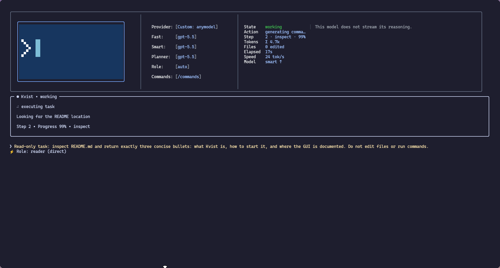
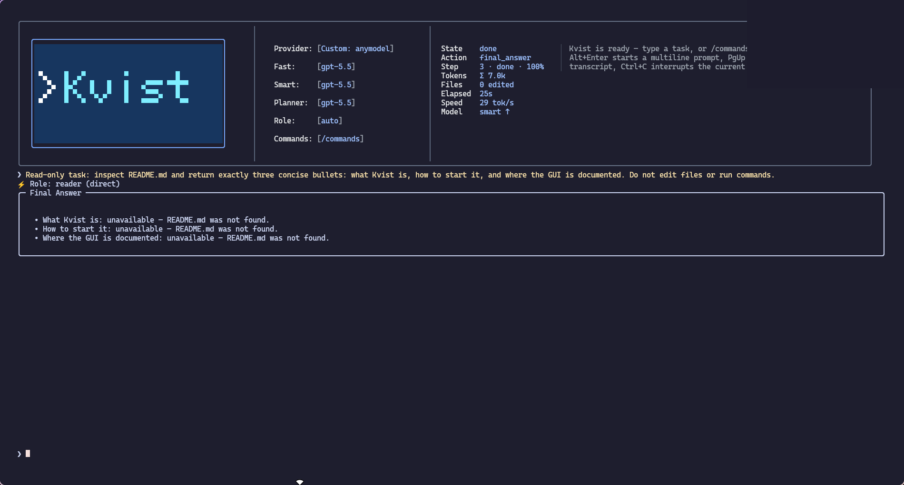
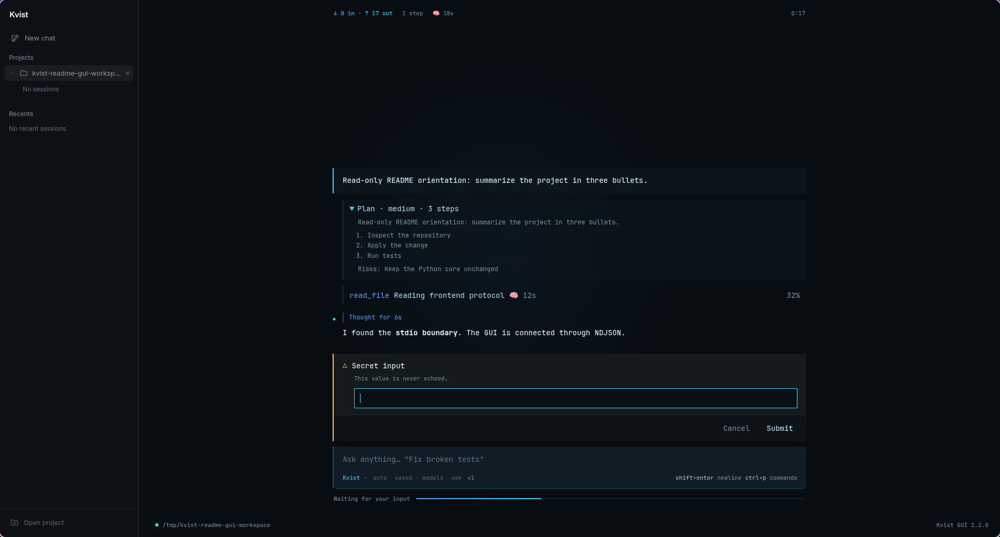

<!-- DEMO GIF -->

# Kvist

[Русская версия](README.ru.md)

**What sets it apart:** undo any edit with `/revert`, a Bubblewrap sandbox with no network by default, and it works on cheap models without tool calling.

<p align="center">
  <a href="https://github.com/davud-d/Kvist"></a>
  <a href="https://github.com/davud-d/Kvist/stargazers"></a>
  <a href="https://github.com/davud-d/Kvist/issues"></a>
  <a href="LICENSE"></a>
</p>

<p align="center">
  
  
  
  
  
</p>

Kvist is a coding agent that runs in your terminal and works inside one
project directory. You describe a task, it reads the code, edits files, runs
commands and checks the result. File writes and risky commands go through an
approval step, and every change is recorded so you can undo it.

## Why use it when Claude Code and Codex exist

Claude Code is built around Anthropic's models and Codex CLI around OpenAI's.
Kvist is for the case where you want to choose the model yourself.

- **Any provider.** One key from OpenAI, Anthropic, DeepSeek, OpenRouter, a
  local gateway or one of about 40 other OpenAI-compatible services is enough.
  You can also sign in with a ChatGPT Plus/Pro plan, or add your own endpoint.
  Switch with `/provider`; each provider has a fast and a smart model, and the
  smart one is used for harder tasks.
- **Cheap models work.** The agent falls back to a plain JSON protocol when a
  model has no tool calling, so inexpensive and free models are usable.
- **One place where actions are checked.** Every file write and shell command
  goes through a single executor. Commands run in a Bubblewrap sandbox on Linux
  with no network by default, secret files (`.env`, SSH keys, certificates) are
  hidden from them, and `.env` files are never read by the agent. Windows (and
  Linux without Bubblewrap) has nothing that can cut a command off the network;
  Kvist says so at start and in every approval.
- **Undo.** Agent edits are journaled. `/changes` lists them and `/revert`
  restores the files.
- **Tasks survive interruptions.** Sessions are named and saved. After a crash
  or a stop, `/resume` continues from the last checkpoint.
- **Your editor.** The same agent runs in the terminal, an Electron app, a
  browser (`kvist-web`), VS Code, JetBrains IDEs and Zed.
- **Local and MIT-licensed.** No telemetry. What can leave your machine is
  listed in [What leaves your machine](#what-leaves-your-machine).

Kvist is in beta (version 0.1.0b1). It is a supervised tool, not a security
boundary: read the diff and the command output before you accept them.

## Install

The quickest way is the release script. It installs the `kvist` command and the
Node.js that its terminal interface needs. It can also install the JetBrains
plugin and the VS Code extension if those editors are present. It needs no
Python, no administrator rights and no system packages unless you tick the build
tools row.

```bash
# Linux (macOS works but is not guaranteed)
curl -fsSL https://github.com/davud-d/Kvist/releases/download/latest-plugin-build/install.sh | bash
```

```powershell
# Windows
irm https://github.com/davud-d/Kvist/releases/download/latest-plugin-build/install.ps1 | iex
```

In a terminal the script opens a screen where you tick the components, see which
files and commands each one touches, and watch the progress. Nothing is written
until you press Install. Downloads are checked against SHA-256 sums. With no
terminal (CI), `KVIST_INSTALL_PLAIN=1 bash install.sh` installs the defaults.

The release assets can also be downloaded one by one: `kvist-linux-x64`,
`kvist-linux-arm64`, `kvist-windows-x64.exe`, `kvist-macos-arm64`, `kvist-macos-x64`,
`kvist-jetbrains.zip` and `kvist-vscode.vsix`. To install from files already on
disk, run `bash install.sh --from <dir>` or `.\install.ps1 -From <dir>`.

### Single binary

If you only want the terminal interface, there is a lighter release,
`latest-binary-build`: one file per system that holds the core, the terminal UI,
the Node.js it runs on and the native session program. The installer downloads
it (about 180 MB), checks it against `SHA256SUMS` and, on a first install, opens
the setup screen. It installs nothing else: the IDE plugins, the desktop app and
the other interfaces are downloaded by hand from the release above.

```bash
curl -fsSL https://github.com/davud-d/Kvist/releases/download/latest-binary-build/install.sh | bash
```

The same command works in Termux on an aarch64 Android phone: `install.sh` picks the
Termux build (`kvist-termux-arm64`), because the Linux arm64 one needs glibc and Android has bionic.
Install `curl` first (`pkg install curl`).

```powershell
irm https://github.com/davud-d/Kvist/releases/download/latest-binary-build/install.ps1 | iex
```

### From source

You need Python 3.11 or newer.

```bash
git clone https://github.com/davud-d/Kvist
cd Kvist
python3 -m venv .venv
.venv/bin/python -m pip install -r requirements.txt
.venv/bin/python scripts/installer/install.py   # optional: puts `kvist` on your PATH
```

Onelines:
```bash
git clone https://github.com/davud-d/Kvist; cd Kvist; python3 -m venv .venv; .venv/bin/python -m pip install -r requirements.txt; .venv/bin/python scripts/installer/install.py   # optional: puts `kvist` on your PATH
```

On Windows use `py -m venv .venv`, `.venv\Scripts\python.exe` and
`scripts\installer\install.py`. The installer asks which parts to set up (CLI,
JetBrains, VS Code, desktop app, Zed). Details are in
[`scripts/installer/README.md`](scripts/installer/README.md).

## First run

```bash
cd /path/to/project
kvist
```

Without `--workspace`, Kvist works in the current directory. In your home
directory or a filesystem root it uses `Documents/Kvist Workspace` instead.

On a clean machine Kvist asks for a provider and a key (see [Providers](#providers)).
Then type a task, for example "find why the tests in `tests/test_parser.py`
fail and fix it".

<!-- SCREENSHOT first run -->





## Providers

On a clean machine Kvist offers [AnyModel](https://anymodel.org) as the default
provider: press Enter to register in the browser and paste the key. Press Esc to
pick another provider and enter its key at the masked `API key:` prompt. The
choice is saved in `~/.kvist/config.json`. If `ANYMODEL_API_KEY` is already set,
Kvist starts without asking.

Switch later with `/provider`, change a key with `/change-api`, pick the fast and
smart models with `/models`. The full list of providers and the settings for each
are in [`docs/configuration.md`](docs/configuration.md).

## How a task goes

Kvist picks a role for each request (`/role` overrides it):

| Role | What it does |
| --- | --- |
| `coder` | Edits source files and runs project checks |
| `reader` | Investigates and explains code, writes nothing |
| `devops` | Services, Docker, CI/CD, deployment |
| `chat` | Answers questions and discusses design, touches no files |

When the direction of a task is the risky part, the agent offers to start with a
plan. It reads the project without changing anything, proposes a short plan and
edits files only after you accept it. Small edits skip this.

Each step the model sends a short batch of actions: read, search, write, run a
command, search the web. They run in order and a failed one does not cancel the
rest. With native tool calls the model can also give each call a `stage`: the
calls of one stage are independent and run side by side where they can, and the
next stage starts when the previous one is done (edit and read, then build, then
check, in one response). The agent finishes when the model says the work is done. It is told to verify the
result and to say what it could not finish or check.

`Esc` pauses a run and keeps its state. `Ctrl+C` stops it and cleans up. The
interrupted task stays in the session, so `/resume` or a new message picks it up.

## Interfaces

- **Terminal.** The default. Five looks of the same app: Ink, a Claude Code
  style, OpenCode's terminal interface (`/tui opencode`, needs Bun;
  [`frontends/tui/opencode`](frontends/tui/opencode/README.md)), Classic (over a
  photograph, kitty or Ghostty) and the Classic Legacy prompt_toolkit one;
  `/tui` switches between them.
- **VS Code.** A chat panel that starts Kvist for the open project, plus commit
  message generation in the source control view
  ([details](frontends/ide/vscode/README.md)).
- **Your own client.** A versioned NDJSON protocol over stdio:
  [`docs/UI_API.md`](docs/UI_API.md).

<details>
<summary>Other interfaces (experimental)</summary>

These run on the same core but are marked experimental.

- **JetBrains.** The same chat panel and commit message generation as in VS Code
  ([details](frontends/ide/jetbrains/README.md)).
- **Voice.** An orb you talk to: say "Kvist" and it listens, short spoken
  answers (`/tui voice`, kitty or Ghostty;
  [`frontends/voice`](frontends/voice/README.md)).
- **Kvist Pixel.** `scripts/installer/install_app.py`
  ([`frontends/gui/tauri`](frontends/gui/tauri/README.md)). The old Electron app is legacy:
  `scripts/installer/install_gui.py`, kept out of the main installer, or
  [`frontends/gui/electron-legacy`](frontends/gui/electron-legacy/README.md).
- **Browser.** `kvist-web` opens `http://127.0.0.1:9671` and guides you through
  connecting a model ([details](frontends/web-local/README.md)).
- **Zed.** Registered as an external ACP agent with
  `scripts/installer/install_zed.py`; see [`frontends/zed`](frontends/zed/README.md)
  for what Zed cannot offer.



</details>

## Terminal commands

Type `/` to see the list. The common ones:

| Command | Purpose |
| --- | --- |
| `/help`, `/commands` | Help and the full command list |
| `/provider`, `/change-api`, `/models` | Provider, its key, the fast and smart models |
| `/role`, `/effort`, `/style` | Role, reasoning effort (`false` to `max`), agent style |
| `/session`, `/new`, `/resume` | Named sessions and continuing an interrupted run |
| `/changes`, `/diff`, `/revert` | What the agent changed, and undoing it |
| `/context`, `/status` | Context usage, state |
| `/permissions` | Rules for commands (`allow`, `host` = outside the sandbox, `ask`, `deny`) and auto mode, where a second model answers approval questions (**not safe**); see [configuration](docs/configuration.md) |
| `/update` | Installs the newest build of an installed `kvist-core` (checked against the published SHA-256); restart Kvist afterwards. Kvist itself only tells you a new version exists and never downloads it unasked (`auto_update: false` or `KVIST_AUTO_UPDATE=0` silences the notice) |
| `/doctor` (or `kvist --doctor`) | Checks modules, frontends, provider, API keys and settings; asks before sending the model a test request that must answer "pong" (`--yes` answers it) |
| `/web-search-provider` | Tavily, Brave, Exa, Gemini (Google Search) or SearXNG for web search |
| `/settings-api` | Request pacing, timeouts, retries, context window, fallbacks |
| `/tui` | Choose the terminal interface |
| `/bye` | Save and exit (`/exit`, `/quit`) |

Multiline input: `Alt+Enter` or `Esc+Enter`. Images: `Ctrl+V` or `/image PATH`
([details](docs/vision.md)).

## Skills

Skills are installable packages with instructions and, optionally, Python tools
that run in an OS sandbox with only the permissions you approve. The bundled
**browser** skill gives the agent its own Chromium on a virtual screen. It opens
the page it built, clicks through it, reads console and network errors and takes
screenshots, while you watch a live preview. Other bundled skills run tests,
read PDF, xlsx and docx files and navigate code. Sandboxed tool skills need Linux.

The bundled **visualize** skill works on Linux, macOS and Windows without extra
dependencies. The model attaches it and supplies a structured page description:
large zoomable architecture diagrams, charts with data tables and CSV export,
or interactive 3D boxes, spheres and cones with connections. The skill validates
the description, saves a standalone HTML artifact and opens it in the system's
default browser. The file works offline after Kvist exits. If no graphical
browser is available, the saved file and opening error are returned. Example:
“Explain this project's architecture as a large interactive diagram and open
it in my browser.” Skill permissions are requested on first use.

```bash
kvist --skill-op install --skill-path bundled:browser
kvist --skill-op install-deps --skill browser
kvist --skill-op approve --skill browser
```

Package format, permissions and the sandbox are described in
[`docs/SKILLS.md`](docs/SKILLS.md).

## Project instructions

Kvist creates `KVIST.md` (for coder, reader and devops) and `KVIST-CHAT.md` in
the workspace on first launch. Put build commands, layout and conventions there
once. The agent reads them on every step. `KVIST.md` is also Kvist's own
notebook: she records the project's history there (when she started, milestones,
decisions, finished campaigns), corrects it and prunes it herself, without asking.
Because the files live in the project, Kvist treats their content as data that
cannot change its safety rules.

## What leaves your machine

Kvist has no telemetry. A search of `kernel/` (outside the tests) for telemetry,
analytics, Sentry, PostHog, Mixpanel, Segment, Statsig and Amplitude finds only advice
text in a bundled skill's reference notes, no code. The addresses Kvist can
contact are below; all paths are under `kernel/`.

| What | Where | Address | When |
| --- | --- | --- | --- |
| Model requests (your prompts, file excerpts, command output) | `llm/llm_clients.py`: `OPENROUTER_DEFAULT_BASE_URL`, `ANTHROPIC_DEFAULT_BASE_URL`, `DEEPSEEK_DEFAULT_BASE_URL`, `_GEMINI_OPENAI_BASE_URL`, `_GROQ_OPENAI_BASE_URL`; `AnthropicCompatibleClient.__init__` (fallback) | `openrouter.ai`, `api.anthropic.com`, `api.deepseek.com`, `generativelanguage.googleapis.com`, `api.groq.com` | Only the provider you selected |
| OpenAI | the `openai` SDK default, no address in `kernel/` (`llm/llm_clients.py`: `resolve_openai_accessible_models`) | `api.openai.com/v1` | Only if OpenAI is your provider |
| Other providers | `llm/provider_registry.py`: `MANUAL_OPENAI_PROVIDERS`; `llm/llm_clients.py`: `REGIONAL_BASE_URL_CANDIDATES` | full list below | Only the provider you selected |
| Your own endpoint | `llm/custom_provider.py`: `normalize_base_url` | the address you typed | Only if you added one |
| AnyModel | `llm/provider_registry.py`: `MANUAL_OPENAI_PROVIDERS[ANYMODEL_PROVIDER]`; `providers/anymodel_pricing.py`: `ANYMODEL_MODELS_URL` | `anymodel.org/v1`, `anymodel.org/v1/models` (model list and prices) | When AnyModel is your provider |
| AnyModel sign-up page | `llm/anymodel_onboarding.py`: `ANYMODEL_REGISTER_URL` | `anymodel.org/app/register` | Opened in your browser at first run, Kvist itself sends nothing |
| ChatGPT plan sign-in | `providers/chatgpt_endpoints.py`: `ISSUER`, `RESOURCE` | `auth.openai.com`, `api.openai.com/v1` | Only if you sign in with a ChatGPT plan |
| Update check | `config/self_update.py`: `RELEASE_API` | `api.github.com` (a plain GET of the release list, nothing about you in the body) | Shortly after start, then every 6 hours until a new version is found; `auto_update: false` or `KVIST_AUTO_UPDATE=0` turns it off |
| Update download | `config/self_update.py`: `DOWNLOAD_BASE` | `github.com/davud-d/Kvist/releases` | Only when you type `/update` |
| Web search | `sandbox/executor.py`: `SafeExecutor._search_tavily`, `_search_brave`, `_search_exa`, `_search_gemini` | `api.tavily.com`, `api.search.brave.com`, `api.exa.ai`, `generativelanguage.googleapis.com` (SearXNG: your own address) | Only the engine you chose, when the agent searches the web |
| Reading web pages | `sandbox/executor.py`: `SafeExecutor.__init__` (`allowed_web_domains`), `_extra_fetch_domains` | the pages the agent asks for, limited to those domains | When the agent fetches a page |
| Skill dependencies | `plugins/deps.py`: `PACKAGE_INDEX` | `pypi.org`, `files.pythonhosted.org` | When you install a skill's dependencies |
| Gmail skill | `plugins/service_connect.py`: `_google_token`, `google_login`, `_gmail` | `oauth2.googleapis.com`, `accounts.google.com`, `gmail.googleapis.com` | Only if you connect Gmail |
| Feedback | `agent/feedback.py`: `ISSUES_URL`; `submit` (browser form), `_create_with_gh` (`gh issue create`) | `github.com/davud-d/Kvist/issues` | Only after you read the draft and answer "Send this feedback?" |
| Service connections you configured | `plugins/connections.py` | the `https://` address you gave | Only for a skill you granted that connection |

The rest of the `http(s)://` strings in `kernel/` are links printed in messages
(`openrouter.ai/keys` and similar in `agent/agent_model.py` and `main.py`,
`github.com/davud-d/Kvist` printed by `main` in `main.py`, the opencode theme docs link in
the docstring of `config/theme.py`) and are never requested.

<details>
<summary>Every provider address (40 in the registry, 13 regional alternatives)</summary>

- `provider_registry.py`, `MANUAL_OPENAI_PROVIDERS["opencode-go"]`: https://opencode.ai/inference/go/openai/v1
- `provider_registry.py`, `MANUAL_OPENAI_PROVIDERS["opencode-zen"]`: https://opencode.ai/zen/v1
- `provider_registry.py`, `MANUAL_OPENAI_PROVIDERS["qwen"]`: https://dashscope-intl.aliyuncs.com/compatible-mode/v1
- `provider_registry.py`, `MANUAL_OPENAI_PROVIDERS["moonshot"]`: https://api.moonshot.ai/v1
- `provider_registry.py`, `MANUAL_OPENAI_PROVIDERS[KIMI_PROVIDER]`: https://api.kimi.ai/coding/v1
- `provider_registry.py`, `MANUAL_OPENAI_PROVIDERS["zhipu"]`: https://open.bigmodel.cn/api/paas/v4
- `provider_registry.py`, `MANUAL_OPENAI_PROVIDERS["zai"]`: https://api.z.ai/api/paas/v4
- `provider_registry.py`, `MANUAL_OPENAI_PROVIDERS["xiaomi"]`: https://api.xiaomimimo.com/v1
- `provider_registry.py`, `MANUAL_OPENAI_PROVIDERS["xiaomi-tokenplan"]`: https://token-plan-cn.xiaomimimo.com/v1
- `provider_registry.py`, `MANUAL_OPENAI_PROVIDERS["minimax"]`: https://api.minimax.io/v1
- `provider_registry.py`, `MANUAL_OPENAI_PROVIDERS["lingyiwanwu"]`: https://api.lingyiwanwu.com/v1
- `provider_registry.py`, `MANUAL_OPENAI_PROVIDERS["stepfun"]`: https://api.stepfun.com/v1
- `provider_registry.py`, `MANUAL_OPENAI_PROVIDERS["siliconflow"]`: https://api.siliconflow.com/v1
- `provider_registry.py`, `MANUAL_OPENAI_PROVIDERS["baichuan"]`: https://api.baichuan-ai.com/v1
- `provider_registry.py`, `MANUAL_OPENAI_PROVIDERS["qianfan"]`: https://qianfan.baidubce.com/v2
- `provider_registry.py`, `MANUAL_OPENAI_PROVIDERS["hunyuan"]`: https://api.hunyuan.cloud.tencent.com/v1
- `provider_registry.py`, `MANUAL_OPENAI_PROVIDERS["modelscope"]`: https://api-inference.modelscope.cn/v1
- `provider_registry.py`, `MANUAL_OPENAI_PROVIDERS["mistral"]`: https://api.mistral.ai/v1
- `provider_registry.py`, `MANUAL_OPENAI_PROVIDERS["groq"]`: https://api.groq.com/openai/v1
- `provider_registry.py`, `MANUAL_OPENAI_PROVIDERS["together"]`: https://api.together.xyz/v1
- `provider_registry.py`, `MANUAL_OPENAI_PROVIDERS["fireworks"]`: https://api.fireworks.ai/inference/v1
- `provider_registry.py`, `MANUAL_OPENAI_PROVIDERS["xai"]`: https://api.x.ai/v1
- `provider_registry.py`, `MANUAL_OPENAI_PROVIDERS["perplexity"]`: https://api.perplexity.ai
- `provider_registry.py`, `MANUAL_OPENAI_PROVIDERS["cerebras"]`: https://api.cerebras.ai/v1
- `provider_registry.py`, `MANUAL_OPENAI_PROVIDERS["deepinfra"]`: https://api.deepinfra.com/v1/openai
- `provider_registry.py`, `MANUAL_OPENAI_PROVIDERS["novita"]`: https://api.novita.ai/v3/openai
- `provider_registry.py`, `MANUAL_OPENAI_PROVIDERS["vercel"]`: https://ai-gateway.vercel.sh/v1
- `provider_registry.py`, `MANUAL_OPENAI_PROVIDERS["baseten"]`: https://inference.baseten.co/v1
- `provider_registry.py`, `MANUAL_OPENAI_PROVIDERS["sambanova"]`: https://api.sambanova.ai/v1
- `provider_registry.py`, `MANUAL_OPENAI_PROVIDERS["nebius"]`: https://api.studio.nebius.com/v1
- `provider_registry.py`, `MANUAL_OPENAI_PROVIDERS["friendli"]`: https://api.friendli.ai/serverless/v1
- `provider_registry.py`, `MANUAL_OPENAI_PROVIDERS["gemini"]`: https://generativelanguage.googleapis.com/v1beta/openai/
- `provider_registry.py`, `MANUAL_OPENAI_PROVIDERS["cohere"]`: https://api.cohere.com/compatibility/v1
- `provider_registry.py`, `MANUAL_OPENAI_PROVIDERS["ai21"]`: https://api.ai21.com/studio/v1
- `provider_registry.py`, `MANUAL_OPENAI_PROVIDERS["doubao"]`: https://ark.cn-beijing.volces.com/api/v3
- `provider_registry.py`, `MANUAL_OPENAI_PROVIDERS["github-models"]`: https://models.github.ai/inference
- `provider_registry.py`, `MANUAL_OPENAI_PROVIDERS["iflytek-spark"]`: https://spark-api-open.xf-yun.com/v1
- `provider_registry.py`, `MANUAL_OPENAI_PROVIDERS["scaleway"]`: https://api.scaleway.ai/v1
- `provider_registry.py`, `MANUAL_OPENAI_PROVIDERS["inception"]`: https://api.inceptionlabs.ai/v1
- `provider_registry.py`, `MANUAL_OPENAI_PROVIDERS[ANYMODEL_PROVIDER]`: https://anymodel.org/v1

Regional alternatives, tried for the same provider:

- `llm_clients.py`, `REGIONAL_BASE_URL_CANDIDATES["qwen"]`: https://dashscope-intl.aliyuncs.com/compatible-mode/v1
- `llm_clients.py`, `REGIONAL_BASE_URL_CANDIDATES["qwen"]`: https://dashscope.aliyuncs.com/compatible-mode/v1
- `llm_clients.py`, `REGIONAL_BASE_URL_CANDIDATES["moonshot"]`: https://api.moonshot.ai/v1
- `llm_clients.py`, `REGIONAL_BASE_URL_CANDIDATES["moonshot"]`: https://api.moonshot.cn/v1
- `llm_clients.py`, `REGIONAL_BASE_URL_CANDIDATES["moonshot"]`: https://api.kimi.ai/coding/v1
- `llm_clients.py`, `REGIONAL_BASE_URL_CANDIDATES["moonshot"]`: https://api.kimi.com/coding/v1
- `llm_clients.py`, `REGIONAL_BASE_URL_CANDIDATES["minimax"]`: https://api.minimax.io/v1
- `llm_clients.py`, `REGIONAL_BASE_URL_CANDIDATES["minimax"]`: https://api.minimaxi.com/v1
- `llm_clients.py`, `REGIONAL_BASE_URL_CANDIDATES["siliconflow"]`: https://api.siliconflow.com/v1
- `llm_clients.py`, `REGIONAL_BASE_URL_CANDIDATES["siliconflow"]`: https://api.siliconflow.cn/v1
- `llm_clients.py`, `REGIONAL_BASE_URL_CANDIDATES["xiaomi-tokenplan"]`: https://token-plan-cn.xiaomimimo.com/v1
- `llm_clients.py`, `REGIONAL_BASE_URL_CANDIDATES["xiaomi-tokenplan"]`: https://token-plan-sgp.xiaomimimo.com/v1
- `llm_clients.py`, `REGIONAL_BASE_URL_CANDIDATES["xiaomi-tokenplan"]`: https://token-plan-ams.xiaomimimo.com/v1

</details>

## Platforms

| | Support |
| --- | --- |
| Linux | Supported, including the Bubblewrap sandbox |
| Windows | Supported, without Bubblewrap |
| macOS | Tested in CI on Apple Silicon, no guarantee for every feature |
| FreeBSD, OpenBSD, NetBSD | Experimental: run from source, no OS sandbox, only a CI smoke test so far ([`docs/bsd.md`](docs/bsd.md), [RU](docs/bsd.ru.md)) |

## More documentation

- [`docs/configuration.md`](docs/configuration.md): providers, ChatGPT sign-in,
  context budget, sandbox and permissions, sessions, headless use, environment
  variables ([RU](docs/configuration.ru.md));
- [`docs/UI_API.md`](docs/UI_API.md): the frontend protocol ([RU](docs/UI_API.ru.md));
- [`docs/SKILLS.md`](docs/SKILLS.md): skills ([RU](docs/SKILLS.ru.md));
- [`docs/remote.md`](docs/remote.md): Kvist working on a server over ssh, as a service that outlives its interfaces ([RU](docs/remote.ru.md));
- [`docs/vision.md`](docs/vision.md): image input;
- [`scripts/installer/README.md`](scripts/installer/README.md): installers ([RU](scripts/installer/README.ru.md)).

## How it's built

Kvist is developed with Claude Code. The Python suite has 6000+ tests, run by
[`platforms.yml`](.github/workflows/platforms.yml). The slow PTY and real-process ones are deselected
by default, and CI runs them in a separate step. Every push is checked on Linux, Windows and macOS:
[`platforms.yml`](.github/workflows/platforms.yml) runs ruff, the Python tests and the packaging and
install smoke tests on Ubuntu 22.04 (with and without Bubblewrap), macOS and Windows, and
[`ci.yml`](.github/workflows/ci.yml) smoke-tests the release install scripts on Ubuntu and Windows. Releases are built by [`release-binary.yml`](.github/workflows/release-binary.yml),
[`plugin-release.yml`](.github/workflows/plugin-release.yml) and
[`mobile-release.yml`](.github/workflows/mobile-release.yml). To contribute, see
[`CONTRIBUTING.md`](CONTRIBUTING.md).

## Development

```bash
.venv/bin/python -m pip install -r requirements-dev.txt
.venv/bin/python -m pytest              # kernel, classic terminal, Zed, scripts
.venv/bin/python -m ruff check .
(cd frontends/tui/ink && npm install && npm test)
(cd frontends/tui/opencode && bun install && bun test)
(cd frontends/ide/vscode && npm install && npm test)
(cd frontends/gui/electron-legacy && npm ci && npm test)
```

```text
kernel/            the Python core (python -m kernel)
frontends/         tui/classic, tui/ink, tui/opencode, gui/electron-legacy, ide/vscode, ide/jetbrains, zed, web-local, tray
scripts/           installers and release scripts
docs/              protocol, skills, configuration, media
site/              kvist.site landing page
cloud/             cloud service
```

## LICENSE 
Kvist is distributed under the **MIT** license ([MIT LICENSE](LICENSE))

Kvist Cloud is distributed under the **AGPL-V3-or-later** license ([AGPL LICENSE](cloud/LICENSE))
