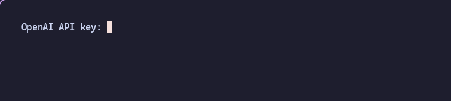
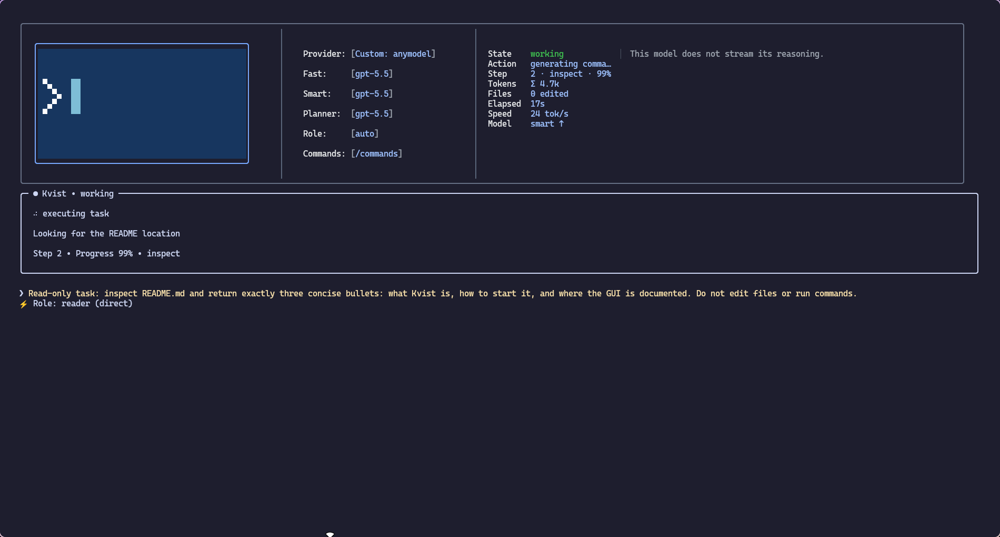
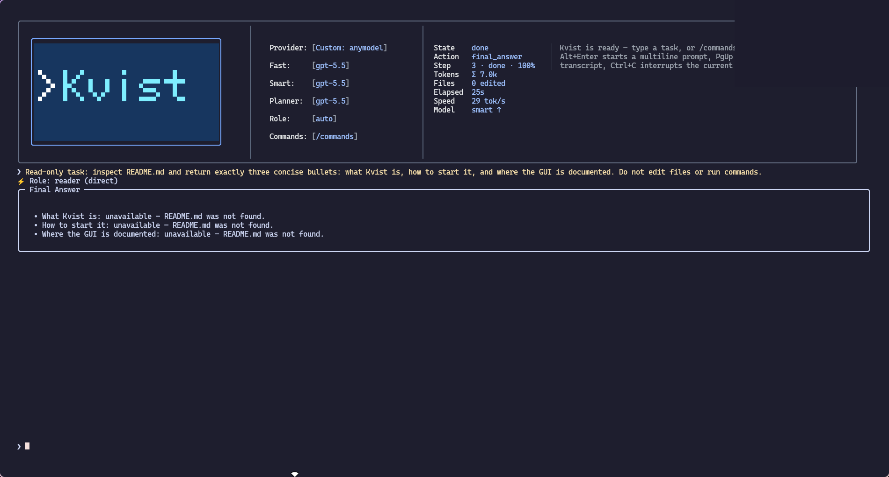
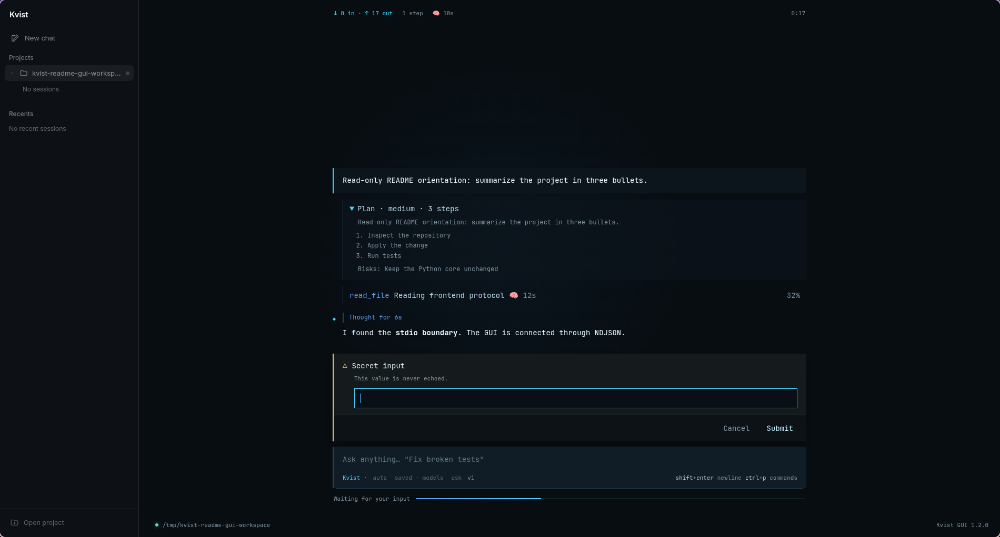

<p align="center">
  
</p>

# Kvist

[Русская версия](README.ru.md)

<p align="center">
  <a href="https://github.com/davud-d/Kvist"></a>
  <a href="https://github.com/davud-d/Kvist/stargazers"></a>
  <a href="https://github.com/davud-d/Kvist/issues"></a>
  <a href="LICENSE"></a>
</p>

<p align="center">
  
  
  
  
  
</p>

Kvist is a coding agent that runs in your terminal and works inside one
project directory. You describe a task, it reads the code, edits files, runs
commands and checks the result. File writes and risky commands go through an
approval step, and every change is recorded so you can undo it.

## Why use it when Claude Code and Codex exist

Claude Code is built around Anthropic's models and Codex CLI around OpenAI's.
Kvist is for the case where you want to choose the model yourself.

- **Any provider.** One key from OpenAI, Anthropic, DeepSeek, OpenRouter, a
  local gateway or one of about 40 other OpenAI-compatible services is enough.
  You can also sign in with a ChatGPT Plus/Pro plan, or add your own endpoint.
  Switch with `/provider`; each provider has a fast and a smart model, and the
  smart one is used for harder tasks.
- **Cheap models work.** The agent falls back to a plain JSON protocol when a
  model has no tool calling, so inexpensive and free models are usable.
- **One place where actions are checked.** Every file write and shell command
  goes through a single executor. Commands run in a Bubblewrap sandbox on Linux
  with no network by default, secret files (`.env`, SSH keys, certificates) are
  hidden from them, and `.env` files are never read by the agent. Windows (and
  Linux without Bubblewrap) has nothing that can cut a command off the network;
  Kvist says so at start and in every approval.
- **Undo.** Agent edits are journaled. `/changes` lists them and `/revert`
  restores the files.
- **Tasks survive interruptions.** Sessions are named and saved. After a crash
  or a stop, `/resume` continues from the last checkpoint.
- **Your editor.** The same agent runs in the terminal, an Electron app, a
  browser (`kvist-web`), VS Code, JetBrains IDEs and Zed.
- **Local and MIT-licensed.** Nothing goes anywhere except the requests to the
  provider you chose.

Kvist is in beta (version 0.1.0b1). It is a supervised tool, not a security
boundary: read the diff and the command output before you accept them.

## Install

The quickest way is the release script. It installs the `kvist` command and the
Node.js that its terminal interface needs. It can also install the JetBrains
plugin and the VS Code extension if those editors are present. It needs no
Python, no administrator rights and no system packages unless you tick the build
tools row.

```bash
# Linux (macOS works but is not guaranteed)
curl -fsSL https://github.com/davud-d/Kvist/releases/download/latest-plugin-build/install.sh | bash
```

```powershell
# Windows
irm https://github.com/davud-d/Kvist/releases/download/latest-plugin-build/install.ps1 | iex
```

In a terminal the script opens a screen where you tick the components, see which
files and commands each one touches, and watch the progress. Nothing is written
until you press Install. Downloads are checked against SHA-256 sums. With no
terminal (CI), `KVIST_INSTALL_PLAIN=1 bash install.sh` installs the defaults.

The release assets can also be downloaded one by one: `kvist-linux-x64`,
`kvist-windows-x64.exe`, `kvist-macos-arm64`, `kvist-macos-x64`,
`kvist-jetbrains.zip` and `kvist-vscode.vsix`. To install from files already on
disk, run `bash install.sh --from <dir>` or `.\install.ps1 -From <dir>`.

### From source

You need Python 3.11 or newer.

```bash
git clone https://github.com/davud-d/Kvist
cd Kvist
python3 -m venv .venv
.venv/bin/python -m pip install -r requirements.txt
.venv/bin/python scripts/installer/install.py   # optional: puts `kvist` on your PATH
```

On Windows use `py -m venv .venv`, `.venv\Scripts\python.exe` and
`scripts\installer\install.py`. The installer asks which parts to set up (CLI,
JetBrains, VS Code, desktop app, Zed). Details are in
[`scripts/installer/README.md`](scripts/installer/README.md).

## First run

```bash
cd /path/to/project
kvist
```

Without `--workspace`, Kvist works in the current directory. In your home
directory or a filesystem root it uses `Documents/Kvist Workspace` instead.

On a clean machine Kvist offers [AnyModel](https://anymodel.org) as the default
provider: press Enter to register in the browser and paste the key. Press Esc to
pick another provider and enter its key at the masked `API key:` prompt. The
choice is saved in `~/.kvist/config.json`. If `ANYMODEL_API_KEY` is already set,
Kvist starts without asking.

Then type a task, for example "find why the tests in `tests/test_parser.py`
fail and fix it".







## How a task goes

Kvist picks a role for each request (`/role` overrides it):

| Role | What it does |
| --- | --- |
| `coder` | Edits source files and runs project checks |
| `reader` | Investigates and explains code, writes nothing |
| `devops` | Services, Docker, CI/CD, deployment |
| `chat` | Answers questions and discusses design, touches no files |

When the direction of a task is the risky part, the agent offers to start with a
plan. It reads the project without changing anything, proposes a short plan and
edits files only after you accept it. Small edits skip this.

Each step the model sends a short batch of actions: read, search, write, run a
command, search the web. They run in order and stop at the first failure. The
agent finishes when the model says the work is done. It is told to verify the
result and to say what it could not finish or check.

`Esc` pauses a run and keeps its state. `Ctrl+C` stops it and cleans up. The
interrupted task stays in the session, so `/resume` or a new message picks it up.

## Interfaces

- **Terminal.** The default. Five looks of the same app: Ink, a Claude Code
  style, OpenCode's terminal interface (`/tui opencode`, needs Bun;
  [`frontends/tui/opencode`](frontends/tui/opencode/README.md)), Classic (over a
  photograph, kitty or Ghostty) and the Classic Legacy prompt_toolkit one;
  `/tui` switches between them.
- **Voice.** An orb you talk to: say "Kvist" and it listens, short spoken
  answers (`/tui voice`, kitty or Ghostty;
  [`frontends/voice`](frontends/voice/README.md)).
- **Electron app.** `scripts/installer/install_gui.py`, or
  [`frontends/gui/electron`](frontends/gui/electron/README.md).
- **Browser.** `kvist-web` opens `http://127.0.0.1:9671` and guides you through
  connecting a model ([details](frontends/web-local/README.md)).
- **VS Code and JetBrains.** A chat panel that starts Kvist for the open
  project, plus commit message generation in the source control view
  ([VS Code](frontends/ide/vscode/README.md),
  [JetBrains](frontends/ide/jetbrains/README.md)).
- **Zed.** Registered as an external ACP agent with
  `scripts/installer/install_zed.py`; see [`frontends/zed`](frontends/zed/README.md)
  for what Zed cannot offer.
- **Your own client.** A versioned NDJSON protocol over stdio:
  [`docs/UI_API.md`](docs/UI_API.md).



## Terminal commands

Type `/` to see the list. The common ones:

| Command | Purpose |
| --- | --- |
| `/help`, `/commands` | Help and the full command list |
| `/provider`, `/change-api`, `/models` | Provider, its key, the fast and smart models |
| `/role`, `/effort`, `/style` | Role, reasoning effort (`false` to `max`), agent style |
| `/session`, `/new`, `/resume` | Named sessions and continuing an interrupted run |
| `/changes`, `/diff`, `/revert` | What the agent changed, and undoing it |
| `/context`, `/status`, `/permissions` | Context usage, state, command permissions |
| `/doctor` (or `kvist --doctor`) | Checks modules, frontends, provider, API keys and settings; asks before sending the model a test request that must answer "pong" (`--yes` answers it) |
| `/web-search-provider` | Tavily, Brave or SearXNG for web search |
| `/settings-api` | Request pacing, timeouts, retries, context window, fallbacks |
| `/tui` | Choose the terminal interface |
| `/bye` | Save and exit (`/exit`, `/quit`) |

Multiline input: `Alt+Enter` or `Esc+Enter`. Images: `Ctrl+V` or `/image PATH`
([details](docs/vision.md)).

## Skills

Skills are installable packages with instructions and, optionally, Python tools
that run in an OS sandbox with only the permissions you approve. The bundled
**browser** skill gives the agent its own Chromium on a virtual screen. It opens
the page it built, clicks through it, reads console and network errors and takes
screenshots, while you watch a live preview. Other bundled skills run tests,
read PDF, xlsx and docx files and navigate code. Sandboxed tool skills need Linux.

The bundled **visualize** skill works on Linux, macOS and Windows without extra
dependencies. The model attaches it and supplies a structured page description:
large zoomable architecture diagrams, charts with data tables and CSV export,
or interactive 3D boxes, spheres and cones with connections. The skill validates
the description, saves a standalone HTML artifact and opens it in the system's
default browser. The file works offline after Kvist exits. If no graphical
browser is available, the saved file and opening error are returned. Example:
“Explain this project's architecture as a large interactive diagram and open
it in my browser.” Skill permissions are requested on first use.

```bash
kvist --skill-op install --skill-path bundled:browser
kvist --skill-op install-deps --skill browser
kvist --skill-op approve --skill browser
```

Package format, permissions and the sandbox are described in
[`docs/SKILLS.md`](docs/SKILLS.md).

## Project instructions

Kvist creates `KVIST.md` (for coder, reader and devops) and `KVIST-CHAT.md` in
the workspace on first launch. Put build commands, layout and conventions there
once. The agent reads them on every step. Because the files live in the project,
Kvist treats their content as data that cannot change its safety rules.

## Platforms

| | Support |
| --- | --- |
| Linux | Supported, including the Bubblewrap sandbox |
| Windows | Supported, without Bubblewrap |
| macOS | Tested in CI on Apple Silicon, no guarantee for every feature |

## More documentation

- [`docs/configuration.md`](docs/configuration.md): providers, ChatGPT sign-in,
  context budget, sandbox and permissions, sessions, headless use, environment
  variables ([RU](docs/configuration.ru.md));
- [`docs/UI_API.md`](docs/UI_API.md): the frontend protocol ([RU](docs/UI_API.ru.md));
- [`docs/SKILLS.md`](docs/SKILLS.md): skills ([RU](docs/SKILLS.ru.md));
- [`docs/vision.md`](docs/vision.md): image input;
- [`scripts/installer/README.md`](scripts/installer/README.md): installers ([RU](scripts/installer/README.ru.md)).

## Development

```bash
.venv/bin/python -m pip install -r requirements-dev.txt
.venv/bin/python -m pytest              # kernel, classic terminal, Zed, scripts
.venv/bin/python -m ruff check .
(cd frontends/tui/ink && npm install && npm test)
(cd frontends/tui/opencode && bun install && bun test)
(cd frontends/ide/vscode && npm install && npm test)
(cd frontends/gui/electron && npm ci && npm test)
```

```text
kernel/            the Python core (python -m kernel)
frontends/         tui/classic, tui/ink, tui/opencode, gui/electron, ide/vscode, ide/jetbrains, zed, web-local, tray
scripts/           installers and release scripts
docs/              protocol, skills, configuration, media
site/              kvist.site landing page
```

Licensed under the [MIT license](LICENSE).
