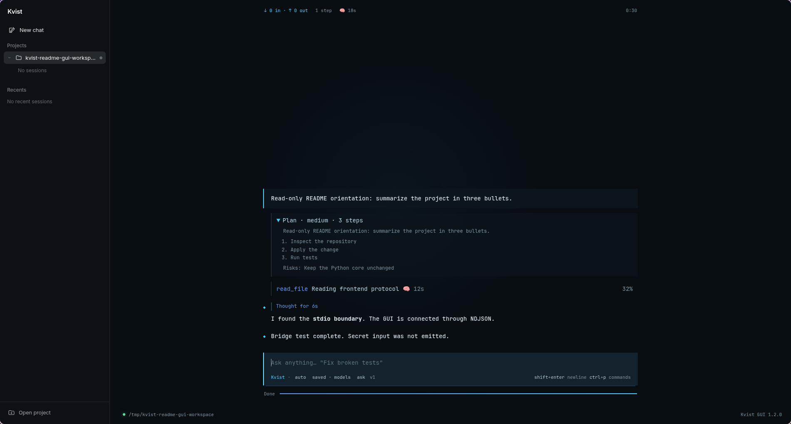

<p align="center">
  <video src="https://github.com/user-attachments/assets/5ed8c7ee-1269-4c85-95cf-3dd66a51b7b0" controls width="480">
    Kvist x AnyModel preview video
  </video>
</p>

# Kvist

[Русская версия](README.ru.md)

<p align="center">
  <a href="https://github.com/davud-d/Kvist"></a>
  <a href="https://github.com/davud-d/Kvist/stargazers"></a>
  <a href="https://github.com/davud-d/Kvist/forks"></a>
  <a href="https://github.com/davud-d/Kvist/issues"></a>
  <a href="https://github.com/davud-d/Kvist/commits"></a>
  <a href="LICENSE"></a>
</p>

<p align="center">
  
  
  
  
  
  
  
  
  
  
  
  
  
  
</p>

<p align="center">
  
  
  
  
  
  
  
</p>

Kvist is a supervised local coding agent. It works in one project workspace at
a time, reads and edits project files, runs development or infrastructure
commands, verifies the result, and keeps resumable named sessions.

The model chooses the workflow, appropriate checks and when to finish. Builds,
analysis and tasks whose requested result already holds can finish without
source edits. The instructions require checking the result and reporting any
unfinished or unverified work honestly. File counts, repeated tool calls,
filenames and answer length do not gate completion. Workspace and secret access
rules, approvals, cancellation and resource limits still apply.

It is a terminal application first, with an Electron GUI, JetBrains, VS Code and
Zed integrations, and a versioned NDJSON frontend protocol for other clients.

## Preview

The previews below show the same short read-only task through its full lifecycle:
`start` means the interface is ready, `working` means the agent is actively
inspecting the workspace, and `end` means the answer is complete with no files
edited.

### Terminal UI in Kitty

On the first terminal launch, run `kvist` in the project directory. Choose a
provider, then enter its API key at the masked `API key:` prompt. The value is
stored in `~/.kvist/config.json`; it is not echoed in the terminal.


### Electron GUI

The Electron frontend uses the same runtime and NDJSON protocol. Select or open
a project, type the task in the composer, and answer any approval or input card
shown in the conversation. Provider credentials are configured by the runtime,
not pasted into the task prompt.




## What it does

Kvist routes a request to one of five roles:

- `coder` — edits source files and runs project checks;
- `reader` — investigates and explains a codebase without making changes;
- `devops` — handles services, Docker, CI/CD, and deployment tasks;
- `chat` — answers questions and discusses architecture without touching files;
- `auto` — selects a role from the request (the default).

On a task where the direction is the risky part, the agent offers to show a
plan first: it explores the project read-only, proposes a short plan, and
changes files only after you accept it. If you decline, it asks what to change
and proposes again. Small edits skip the offer.

Every run has a human-in-the-loop approval gate. File writes and risky commands
are visible and may require confirmation. This is a supervised tool, not an IDE
and not a complete security boundary: review the diff and command output.

## Skills

Kvist can be extended with installable skills: packages with instructions and,
optionally, Python tools that run in an OS sandbox with only the permissions you
approve. A bundled **browser** skill gives the agent its own Chromium on a
separate virtual screen: it opens the page it built, clicks through it, reads
console and network errors and takes screenshots, and you watch a live preview
(top right in the GUI, or a local viewer link). Other bundled skills run tests,
read PDF/xlsx/docx and navigate Python code. `Esc` pauses the task, its
helpers and the skills' work without losing anything; Ctrl+C or "Stop all"
cancels everything and cleans up. Skills are Linux-only for now.

```bash
kvist --skill-op install --skill-path bundled:browser
kvist --skill-op install-deps --skill browser
kvist --skill-op approve --skill browser
```

Package format, permissions, the `ctx` API, the sandbox's guarantees and limits
are in [`docs/SKILLS.md`](docs/SKILLS.md) ([RU](docs/SKILLS.ru.md)).

## Requirements

- Python 3.11 or newer;
- an API key and models for one supported provider;
- a TTY for the interactive terminal configuration and approval prompts.

The CLI is tested in CI on Linux, Windows and macOS (Apple Silicon): installation
and the agent's file and shell tools. Linux and Windows are the supported
platforms; macOS is best-effort, with no guarantee that every feature works
there. The OS-level sandbox (Bubblewrap) exists only on Linux. The optional IDE
integrations support Linux and Windows (macOS best-effort: binaries ship for Apple
Silicon and Intel, unverified on a Mac): the JetBrains plugin targets IntelliJ
Platform 2025.3, and the VS Code extension targets VS Code 1.85+. Both launch
Kvist for the opened project and can write commit messages from the IDE's
source-control UI. Zed runs Kvist as an external ACP agent — that is a settings
entry, not a plugin — and gets the same agent loop, sessions, confirmations and
`/commit-message`; what it cannot get is written down in
[`frontends/zed/README.md`](frontends/zed/README.md).

Built-in providers are OpenAI, ChatGPT Plus/Pro, Anthropic, DeepSeek, OpenRouter, OmniRoute, and
FreeFlow LLM (beta). You can also add custom OpenAI-compatible or
Anthropic-compatible endpoints from `/provider`.

## Install from a release

Every push to `main` rebuilds the rolling
[release](https://github.com/davud-d/Kvist/releases/tag/latest-plugin-build).
One script puts the `kvist` command, the Node.js its terminal interface runs
on, the JetBrains plugin (into every JetBrains IDE found) and the VS Code
extension (VS Code, Insiders, VSCodium) where they belong. It needs no Python
and no Node.js of its own, and by default it uses no administrator rights and
installs no system packages except the ones you leave ticked in a folded "Build
from source" row (click it, or press → and ←). That row holds the system
packages for building Kvist yourself: Python 3 with venv and pip, the Python
headers and binutils. They start ticked, the row shows how many are, and
unticking them keeps sudo out of it; ticked ones are installed with your
package manager under sudo, which asks for your password in the terminal.

In a terminal the script downloads the agent and a pinned Node.js (about
100 MB, checked against a SHA-256) into a temporary folder and opens an
installer screen. There you tick what to install (the agent, Node.js, an
optional static ffmpeg that plays the preview video on Linux x86_64 and macOS, the editor
plugins, the PATH line), see the exact files and commands each item touches,
and watch the progress; the first-run setup follows
in the same window. Node.js and ffmpeg come from whichever of several servers
answers fastest from your connection, and are accepted only if they match a
SHA-256 fixed in the script. Everything on it works with the keyboard alone (arrows,
Space, Enter, Esc), with the mouse alone (click a row to tick it, click the
buttons), or both. Nothing is written until you press Install.

```bash
# Linux and macOS (best-effort)
curl -fsSL https://github.com/davud-d/Kvist/releases/download/latest-plugin-build/install.sh | bash

# the same without the screen (CI, no terminal): installs the defaults
KVIST_INSTALL_PLAIN=1 bash install.sh
```

```powershell
# Windows
irm https://github.com/davud-d/Kvist/releases/download/latest-plugin-build/install.ps1 | iex
```

The assets are also downloadable one by one: `kvist-linux-x64`,
`kvist-windows-x64.exe`, `kvist-macos-arm64`, `kvist-macos-x64`,
`kvist-jetbrains.zip`, `kvist-vscode.vsix`. On macOS the script takes the binary
for the CPU it runs on; the macOS binaries are rebuilt on every tenth push and
whenever the web payload or release wrappers change, so they can still lag
unrelated `main` changes. To install
from files already on disk, run `bash install.sh --from <dir>` or
`.\install.ps1 -From <dir>`. Zed is registered separately with
`scripts/installer/install_zed.py`.

## Install from source

From the repository root:

```bash
python3 -m venv .venv
.venv/bin/python -m pip install -r requirements.txt
```

For development and tests:

```bash
.venv/bin/python -m pip install -r requirements-dev.txt
```

On Windows use `py -m venv .venv` and `.venv\\Scripts\\python.exe`.

## Quick start

For Unix-like systems (Linux, FreeBSD, OpenBSD) in a terminal:

```bash
git clone https://github.com/davud-d/Kvist && echo "Clone OK" || echo "error clone"
cd Kvist
python3 -m venv .venv && echo "venv OK" || echo "error venv" # or python -m venv .venv
source .venv/bin/activate && echo "venv activated" || echo "error activate"
uv pip install -r requirements.txt || echo "uv not found" && pip install -r requirements.txt
python scripts/installer/install.py && echo "Install OK" || echo "error install"
```
**Note**: *works in bash only; if you use a different shell - adapt it*

For Windows PowerShell:

```powershell
git clone https://github.com/davud-d/Kvist; if ($?) { echo "Clone OK" } else { echo "error clone" }
cd Kvist
python -m venv .venv; if ($?) { echo "venv OK" } else { echo "error venv" }
Set-ExecutionPolicy -ExecutionPolicy Bypass -Scope Process -Force
.venv\Scripts\Activate.ps1; if ($?) { echo "venv activated" } else { echo "error activate" }
uv pip install -r requirements.txt; if (!$?) { pip install -r requirements.txt }
python installer\install.py; if ($?) { echo "Install OK" } else { echo "error install" }
```
**Note**: *works in PowerShell **5.1** only; if you use a different PowerShell version - adapt it*

## Run

Without `--workspace`, Kvist works in the directory it was started from. When
that is your home directory or a filesystem root, it uses `Documents/Kvist
Workspace` instead (the XDG documents directory on Linux). If an explicitly
named directory does not exist, Kvist creates it. Relative paths are resolved
from the directory where Kvist starts.

```bash
.venv/bin/python -m kernel --workspace /path/to/project
```

The first interactive launch asks for the provider, models, and credentials and
saves them in `~/.kvist/config.json` (secrets are not printed). Start a new
terminal in the project and run Kvist again to reuse that configuration.

### Web client

```bash
kvist-web        # from a source checkout: .venv/bin/kvist-web
```

`kvist-web` opens Kvist in the browser at `http://127.0.0.1:9671` and walks a first run
through connecting a model. The directory you start it from becomes the working folder;
`kvist-web --workspace /path/to/project` picks another. The installer adds the command
beside `kvist`; details in [frontends/web-local/README.md](frontends/web-local/README.md).

### ChatGPT Plus/Pro (browser sign-in)

Select **ChatGPT Plus/Pro** with `/provider` (provider ID `chatgpt`), or select it
in the web or desktop provider settings. **Continue with ChatGPT** opens OpenAI's
sign-in page in your system browser. Sign in or create an account and authorize
Kvist to use your ChatGPT plan. An eligible Plus or Pro subscription and explicit
plan-usage permission are required; no OpenAI API key is needed.

Kvist uses OpenAI's documented open-source Sign in with ChatGPT flow: dynamic
client registration, authorization code + PKCE, a temporary callback at
`http://127.0.0.1:<port>/auth/callback`, and verified ID tokens. The listener binds
only to loopback and stops on success, cancellation, or after three minutes.
Tokens are saved in the private `chatgpt_oauth` section of `~/.kvist/config.json`
(atomic writes, `0600` on Unix). Refresh tokens rotate under a cross-process lock.
Kvist keeps each account/workspace registration separate and does not import
credentials from Codex or OpenCode. OAuth credentials and the host ID are excluded
from configuration sync; authenticate separately on each computer. For a remote
server, sign in on that computer, where its loopback callback is reachable.

The provider calls `https://api.openai.com/v1/responses` with `store=false` and
`stream=true`, including when Kvist buffers the reply. It supports streaming chat,
images and Kvist's native tools through a namespace, plus the JSON protocol path.
Models are loaded using the signed-in account's catalog; the offline suggestion
is GPT-6.1 Sol. Model availability and actual access remain account-dependent.
A reply succeeds only after `response.completed`; interrupted/incomplete streams
and plan-limit failures are surfaced as errors.

Usage counts against your ChatGPT plan or permitted credits. Plus usage limits
are shared with other apps using the plan; this integration does not provide
unlimited requests. Review limits, credits permissions, and connected apps at
[ChatGPT Settings → Usage](https://chatgpt.com/settings/usage). It does not give
Kvist access to your ChatGPT conversation history.

`/change-api` starts reauthorization for this provider. The web settings also
support selecting a saved account, adding another, cancelling sign-in, and
signing out. Headless operations (JSON payload on stdin):

```bash
python -m kernel --config-op chatgpt-login --config-payload '{}'     # browser sign-in
python -m kernel --config-op chatgpt-accounts --config-payload '{}'  # identities, no tokens
# {"new":true} with chatgpt-login adds an account.
# {"account":"<id>"} selects an existing identity with chatgpt-accounts,
# or reauthorizes that registration with chatgpt-login.
python -m kernel --config-op chatgpt-logout --config-payload '{}'    # revoke session
```

If remote revocation cannot be confirmed, Kvist signs out locally and tells you
to disconnect the app in ChatGPT Settings. Install the updated dependencies before
using this provider (`pip install -r requirements.txt`).

Implementation references: [OpenAI registration and sign-in](https://developers.openai.com/siwc/token-sharing-open-source/sign-in),
[accounts and token renewal](https://developers.openai.com/siwc/token-sharing-open-source/profiles-and-sessions),
[models and inference](https://developers.openai.com/siwc/token-sharing-open-source/models-and-inference),
and [preview restrictions](https://developers.openai.com/siwc/token-sharing-open-source/preview-limitations).

### AnyModel (default provider)

A blank config defaults to [AnyModel](https://anymodel.org). If
`ANYMODEL_API_KEY` is already set in the environment, Kvist starts straight
away with no prompts. Otherwise the first launch offers a dedicated screen:

```
Нет ключа AnyModel. Регистрация займёт минуту.

  Enter — открыть регистрацию в браузере (email + пароль)
  Esc   — выбрать другого провайдера

https://anymodel.org/app/register
```

`Enter` opens the registration page in your browser and asks you to paste the
key once you have one; the key is checked immediately against AnyModel's
catalog endpoint (a bad key is rejected right away, with a retry, instead of
letting the agent start and fail later). `Esc` falls through to the regular
provider picker for any of the other built-in or third-party providers.

The same endpoint AnyModel is checked against also carries the per-model
billing coefficient used for cost tracking:

```bash
curl -H "Authorization: Bearer $ANYMODEL_API_KEY" https://anymodel.org/v1/models
```

Set `AGENT_LLM_PROVIDER` (or run `/provider`) to switch away from AnyModel at
any time — the default only applies to a config that has no provider saved
yet.

To install a reusable `kvist` launcher and build a standalone binary when needed:

```bash
.venv/bin/python scripts/installer/install.py
```

The `scripts/installer/` directory also holds IDE and desktop installers for Linux, Windows and
(best-effort) macOS:

```bash
.venv/bin/python scripts/installer/install_jetbrains.py   # install the plugin into every JetBrains IDE found
.venv/bin/python scripts/installer/install_vscode.py      # install the extension into VS Code / Insiders / VSCodium
.venv/bin/python scripts/installer/install_gui.py         # install the GUI app + launcher/desktop shortcut
.venv/bin/python scripts/installer/install_zed.py         # register kvist-core as a Zed ACP agent
```

### Zed

Zed reaches coding agents over the
[Agent Client Protocol](https://agentclientprotocol.com/), so Kvist ships no
extension there — extension-provided agents are deprecated in Zed and there is
no `extension.toml` in this repository. Run the CLI installer first, then:

```bash
.venv/bin/python scripts/installer/install_cli.py         # puts kvist-core on disk
.venv/bin/python scripts/installer/install_zed.py         # writes one agent_servers entry
```

That entry points Zed at `kvist-core --acp`. Zed re-reads its settings on its
own, so there is no restart. By hand, the whole thing is:

```bash
/path/to/kvist-core --acp
```

The parity this has with the VS Code and JetBrains integrations — and the list
of things Zed has no public API for, such as inline completion — is in
[`frontends/zed/README.md`](frontends/zed/README.md) ([RU](frontends/zed/README.ru.md)).

The VS Code extension is packaged as a `.vsix` from `frontends/ide/vscode/`:

```bash
cd frontends/ide/vscode
./build-plugin.sh      # Linux or macOS host
# or on Windows: .\build-plugin.ps1 / build-plugin.bat
```

The helper builds the current OS Kvist binary with PyInstaller, copies it into
`frontends/ide/vscode/bin/...`, compiles the extension, and writes the package under
`frontends/ide/vscode/.build/vsix/`.

The installer uses `dist/kvist` or `dist/kvist.exe` when available, otherwise
builds it with PyInstaller. It installs the binary under the per-user data
directory and a launcher under `~/.local/bin` on Linux and macOS or `%LOCALAPPDATA%\\Kvist\\bin`
on Windows. On Windows the installer adds that bin directory to your user `PATH`
automatically (open a new terminal afterwards); on Linux and macOS add it yourself
if the installer reports it is missing (it prints the command for your shell). Re-run with `--rebuild` after changing the source.

The installed launcher uses the current directory as the workspace:

```bash
cd /path/to/project
kvist
```

Build manually if you need the artifact only:

```bash
.venv/bin/python -m pip install pyinstaller
.venv/bin/python -m PyInstaller kvist.spec
```

The result is `dist/kvist` on Linux and macOS or `dist/kvist.exe` on Windows.

## Terminal commands

Type `/` to open command completion. The most useful commands are:

| Command | Purpose |
| --- | --- |
| `/help`, `/commands` | Show help or the complete command list |
| `/provider` | Select or configure a provider |
| `/change-api` | Replace the current provider key (`/change_api` and `/apikey` also work) |
| `/models` | Select `fast` and `smart` models |
| `/settings-api` | Tune request pacing, timeout, retries, the context window, dynamic model loading, response cache and model fallbacks (`/api` also works, saved globally) |
| `/role` | Select `auto`, `coder`, `reader`, `devops`, or `chat` |
| `/effort` | Set reasoning effort: `false`, `low`, `medium`, `high`, `xhigh`, `max` (saved globally) |
| `/session` | Create, switch, or delete named sessions |
| `/resume` | Continue the active session's latest checkpoint |
| `/new` | Start a new session; the current one stays available in `/session` |
| `/changes` | Show agent changes recorded in this workspace |
| `/revert` | Restore recorded agent changes when safe |
| `/verbose` | Toggle diagnostic output |
| `/tui` | Choose the terminal interface (Ink, Claude-style or classic); the choice is saved globally. In the Node UIs it opens a picker and switches at once; in the classic terminal `/tui on` / `/tui claude` / `/tui off` select explicitly |
| `/strime` | Toggle streaming for a custom provider |
| `/bye` | Save and exit (`/exit` and `/quit` are aliases) |

Multiline input: `Alt+Enter` or `Esc+Enter`.

Reasoning effort defaults to `medium` and is translated per provider. DeepSeek
maps `medium` and `xhigh` to `high`; `/effort low` requests its lighter thinking
mode, and `/effort false` disables thinking. More reasoning does not guarantee
fewer tool calls or a better result; the same honesty and safety rules apply at
every level. If a provider rejects the setting, Kvist retries without it and warns
once per provider/model per run. `AGENT_REASONING_EFFORT` overrides the saved level
for a launch.

On the first task of a launch, Kvist sends one tiny request to check whether the
active provider and model call tools natively. If they do, the run is one growing
conversation of tool calls and results, which the model keeps across steps and
the provider can cache; if not, the run uses Kvist's JSON protocol as before. A
provider that refuses tools mid-run moves that run to the JSON protocol.
`AGENT_NATIVE_TOOLS=0` keeps every run on the JSON protocol.

During change tasks, sustained inspection prompts the agent to act on sufficient
evidence or identify the specific missing fact. This does not force an edit or
stop legitimate research. Native tool-call token counts use the provider's usage
totals when supplied, including reasoning; otherwise they are local estimates.

Named sessions have 1–64 lowercase letters, digits, `-`, or `_`, and start with
a letter or digit. Each session stores its own history and checkpoint. A
checkpoint is written after every step that changes something and after every
batch of reads, so `/resume` can continue an interrupted run. The change journal
powers `/changes` and `/revert`.

## Headless frontends and scripting

The Ink terminal UI (`frontends/tui/ink/`, Node 22+, TypeScript) is a separate process that
drives the Python core over `--frontend stdio-multi`. It writes to the normal
terminal scrollback, so native scrolling and copying work. Build it once:

```bash
(cd frontends/tui/ink && npm install && npm run build)   # one self-contained file: frontends/tui/ink/dist-ui/kvist-tui.mjs
.venv/bin/python -m kernel --frontend tui   # or: /tui, saved as `frontend`
.venv/bin/python -m kernel --frontend claude   # the same app drawn like Claude Code
```

The Claude-style UI is a second skin of the same app, not another process: `●`
calls with `⎿` results, a `✻` spinner line with the elapsed time, the input
between two rules, and the Kvist mark in the welcome block. Like Claude Code's
fullscreen mode it uses the alternate screen: the welcome block is the top of the
window, the input stays at the bottom and the command list opens above it. The
terminal's scrollback is not available there, so the app scrolls itself
(`PgUp`/`PgDn`, `Ctrl+Home`/`Ctrl+End`, the mouse wheel) and owns the mouse: drag
to select, double-click for a word, triple-click for a line; the selection is
copied on release. Hold `Shift` while dragging to use the terminal's own selection.

The squirrel of the welcome block is drawn as real pictures where the terminal can: kitty's graphics
protocol (kitty, Ghostty, Konsole) or Sixel (Windows Terminal 1.22+, WezTerm, mintty, foot, iTerm2 and
others; Kvist asks the terminal at start). Everywhere else it is block characters: octants (twice as
sharp) in Windows Terminal, whose Cascadia Code font has them, and quadrants in every other terminal.
`KVIST_GLYPHS=octants` or `quadrants` overrides that guess, for a Windows Terminal with another font.

`--frontend terminal` or `--no-banner` overrides the saved choice for one launch.
The Ink UI needs a provider configured in the classic terminal first; without
Node.js, the built file, a provider or a TTY, Kvist starts the classic terminal
instead and says why. The installer (`scripts/installer/install_cli.py`) builds that file
when npm is available and packs it into the `kvist` binary; the binary then needs
Node.js 22+ on `PATH` at run time.
Every slash command works there. `/help`, `/clear`, `/debug` and `/quit` run in the
UI; the rest — `/role`, `/effort`, `/verbose`, `/style`, `/models`,
`/session`, `/new`, `/changes`, `/provider`, `/change-api`, `/settings-api`,
`/strime`, `/del-provider`, `/full-reset`, `/revert` and `/resume` — are run by the
core itself, with their dialogs (searchable lists, masked secrets, confirmations)
drawn by the UI. File edits are shown as diffs (split view from 100 columns), shell
commands with their output. A dangerous command or a file overwrite opens an approval
screen: arrows or 1/2/3 to choose, a click to move the cursor and a double click to
confirm, Esc to deny; "don't ask again" saves the pattern to
`<workspace>/.kvist/permissions.json` and is never offered for an intrinsically
dangerous command. Keys: Enter sends, Esc twice or Ctrl+C stops a run, Ctrl+D quits.

The built-in stdio frontend speaks newline-delimited JSON (NDJSON). Configure a
provider once in the terminal, then launch it from another process:

```bash
.venv/bin/python -m kernel --workspace /path/to/project --frontend stdio
```

The first event is `hello`; events include plans, status, streamed text,
approval requests, errors, and the final response. Replies to `input_request`
must be JSON objects on stdin. The complete wire contract, including session
operations and resume behavior, is in [`docs/UI_API.md`](docs/UI_API.md).

Useful headless commands:

```bash
# Inspect saved provider/model/credential state without an LLM call
.venv/bin/python -m kernel --workspace /path/to/project --config-info

# Manage the active workspace's sessions
.venv/bin/python -m kernel --workspace /path/to/project --session-op status
.venv/bin/python -m kernel --workspace /path/to/project --session-op create --session-name review
.venv/bin/python -m kernel --workspace /path/to/project --session-op switch --session-name review

# Write a commit message for a change payload (used by the JetBrains plugin; UI_API.md §8b)
echo '{"files": [{"path": "app.py", "patch": "+print(1)"}]}' \
  | .venv/bin/python -m kernel --commit-message

# Read or revert the durable change journal
.venv/bin/python -m kernel --workspace /path/to/project --journal-op changes
.venv/bin/python -m kernel --workspace /path/to/project --journal-op revert
```

Per-run stdio overrides include `--provider`, both model flags
(`--fast-model`, `--smart-model`), `--role`, and
`--approval-mode ask|deny`. Model overrides are supplied as a complete set.
`--resume` resumes the active checkpoint without reading a goal line.
`--resume SESSION_ID` selects a specific session checkpoint in Classic, Ink,
and stdio frontends. Use the session id (filename without `.json`), not its
display title. A missing session or checkpoint exits with an error.

## Electron GUI

The GUI starts Kvist as a child process and uses only the stdio protocol; it does
not import Python modules or use HTTP/WebSockets.

```bash
cd frontends/gui/electron
npm ci
npm start -- --workspace /path/to/project
```

Run `npm test` for GUI tests. `npm run dist` builds native Linux (`AppImage`,
`deb`), Windows (`nsis`) or, best-effort, macOS (`dmg`, `zip`) packages; build separately on each target OS. See
[`frontends/gui/electron/README.md`](frontends/gui/electron/README.md) for packaging details.

`frontends/gui/electron/package.json` sets `"workspaces": []` so electron-builder treats it as its
own workspace root instead of walking up to an unrelated monorepo and failing
the build.

## VS Code Extension

The VS Code extension starts Kvist in an integrated terminal for the opened
workspace and adds `Kvist: Generate Commit Message with Kvist` to the Command
Palette and Source Control title bar. Commit-message generation sends the
current Git diff plus recent commit subjects to `kvist --commit-message`; the
extension uses the provider and **fast** model already saved in
`~/.kvist/config.json`, so configure Kvist once in the terminal first.

Build a local VSIX with the same bundled-binary flow as the JetBrains plugin:

```bash
cd frontends/ide/vscode
./build-plugin.sh
```

The script runs on Linux and macOS. On Windows, run `./build-plugin.ps1` from
PowerShell or `build-plugin.bat` from Command Prompt. The package is written to `frontends/ide/vscode/.build/vsix/` and can
be installed with `code --install-extension <file>.vsix` or through Extensions >
Install from VSIX. Details are in [`frontends/ide/vscode/README.md`](frontends/ide/vscode/README.md).

## Zed

Zed runs Kvist as an external agent over the Agent Client Protocol: the agent
process is `kvist-core --acp`, speaking JSON-RPC on stdin/stdout. There is no
Zed extension and no `extension.toml` — Zed deprecated extension-provided
agents and the public way to add an agent is a settings entry.

```bash
.venv/bin/python scripts/installer/install_cli.py
.venv/bin/python scripts/installer/install_zed.py
```

`install_zed.py` writes one `agent_servers` member into Zed's JSONC settings
file, keeping every comment the user has, and refuses to register a binary that
is not installed yet. `--uninstall` removes exactly that entry. The agent gets
the same action loop, sandbox, sessions, confirmations and `/commit-message` as
the terminal; role and reasoning effort are ACP Session Config
Options, and everything else (provider, models, style, sandbox mode) stays in
`~/.kvist/config.json` and the `AGENT_*` variables.

What Zed has no public API for — inline completion as ghost text, a Kvist side
panel, a commit button in the source-control UI — is listed with the official
sources in [`frontends/zed/README.md`](frontends/zed/README.md) ([RU](frontends/zed/README.ru.md)).

## Configuration and boundaries

Global settings live in `~/.kvist/config.json`. Runtime environment variables
include `AGENT_LLM_PROVIDER`, `AGENT_FAST_MODEL`, `AGENT_SMART_MODEL`,
`AGENT_VERBOSE`, `AGENT_MAX_STEPS`,
`AGENT_PERSIST_LOGS`, `AGENT_REASONING_EFFORT`,
`AGENT_MAX_CONTEXT_TOKENS`, `AGENT_NATIVE_TOOLS`, `AGENT_SANDBOX_MODE`, and
`AGENT_SANDBOX_NET`.
Prefer `/provider`, `/models`, `/role`, and `/effort` for interactive
configuration; do not commit keys or local `.kvist` data.

Agent shell commands can request two independent, one-command permissions:
`sandbox: "host"` exposes host tools and files, while `network: true` permits
network access. Either request requires a `justification`; requesting both
produces two confirmations. Project allow rules do not suppress them, and
neither permission can be remembered. The command, directory and reason appear
in the classic/Ink terminals, Electron GUI, web UI, VS Code, JetBrains and Zed.
The tray has no new controls.

`run_shell` defaults to the configured filesystem sandbox with network denied,
even if `AGENT_SANDBOX_NET=allow`; that variable still governs legacy internal
terminal calls. Linux uses Bubblewrap network namespaces (also in host mode),
and macOS uses `/usr/bin/sandbox-exec` for offline host execution. Windows has no
offline host backend without an installed system component: Kvist refuses such
a command rather than silently allowing network. The same refusal applies if
the required Linux/macOS backend is absent. A host command with network access
can run only after both permissions are approved. No system component is
installed automatically. Host mode retains a private HOME, a sanitized
environment, command/path validation and the user's existing OS privileges;
it does not grant administrator rights. Its filesystem is no longer isolated.

How much context a step may occupy is derived from the *active model's*
documented **input** limit (`context_budget.py`), not from one flat number. Input
limit, not context window: OpenAI reserves its 128k max output inside the window,
so a 400k-window GPT-5 model refuses any prompt over 272k, while Anthropic bounds
the input alone and a 1M model really does take a 1M-token prompt. The budget is
85% of that limit, because Kvist counts tokens with tiktoken, which under-counts
for the Anthropic and DeepSeek tokenizers — so a 1M model gets 850k and a
272k-input one gets 231k.

Because Kvist discovers the model catalog from `/v1/models` on every launch and
no provider reports a context size there, a model newer than that table is
expected: an unlisted member of a known family inherits its generation (a new
`gpt-6-*`, a new `claude-opus-*`) instead of dropping to a generic 256k, and
`-mini`/`-nano` variants stay on the small tier. If a guess still comes out too
high, the provider's own "prompt is too long" rejection lowers the budget for
that model and the call is re-sent rather than failing. Set
`AGENT_MAX_CONTEXT_TOKENS` to pin a budget yourself.

`/settings-api` is the interactive form of the same transport knobs, saved
globally in `~/.kvist/config.json` under `api_settings`: the minimum gap between
two requests (a number applies to every provider, `0` removes the pacing
entirely), the per-call timeout, retry count and backoff, the prompt budget
(`auto` derives it as above, or set it yourself — `1m`, `250k`), whether the
model catalog is discovered from `/v1/models` at launch at all, the in-run
response cache, and runtime model fallbacks. Only knobs you actually change are
written; `AGENT_API_INTERVAL` and `AGENT_MAX_CONTEXT_TOKENS` still win over the
saved values, and the dialog says so on the affected row.

Two instruction files sit in the workspace root: `KVIST.md` for the action-loop
roles (coder, reader, devops) and `KVIST-CHAT.md` for chat. Kvist creates both
from a template on first launch and appends their contents to the role system
prompt, so a project states its build commands, layout and conventions once
instead of repeating them in every task; edits take effect from the next step.
If the workspace already has a `.gitignore`, both names are appended to it once
under a comment — without a `.gitignore` nothing is written. Because these files
live in the workspace, their contents are treated as untrusted: they are quoted
into the prompt as delimited data, bounded by instructions that scope them to
commands, layout and conventions and rule out changing the agent's role, safety
rules or action protocol. That raises the cost of a hostile instruction file and
makes the attempt reportable; it is not a guarantee. The gates that do not read
the prompt — command validation, secret masking, the workspace boundary, and the
approval prompts — remain the actual boundary.

Writes and shell commands stay inside the workspace. Read-only actions may use
repeatable `--allow-read DIR` paths. Project command policy is stored at
`.kvist/permissions.json` with `allow`, `deny`, and `ask` patterns; deny and
hard safety blocks always win. Network access is denied by the restricted
sandbox when available, and approval is fail-closed when no TTY/frontend answer
exists.

## Repository layout

```text
kernel/            the Python core (python -m kernel): agent loop, executor, providers, sessions, prompts
frontends/
  tui/classic/     classic terminal (Python, prompt_toolkit)
  tui/ink/         Ink terminal UI (TypeScript), skins kvist and claude-code
  gui/electron/    desktop app (Electron)
  ide/vscode/      VS Code extension and the chat panel shared with JetBrains
  ide/jetbrains/   IntelliJ plugin
  zed/             Zed agent over ACP
scripts/           installers, run_task.py, package_script.py
branding/          icons and logos
docs/              frontend protocol (UI_API) and README media
site/              kvist.site landing page
```

Each component keeps its tests next to it (`kernel/tests/`, `frontends/*/tests/`, …).

## Tests and lint

```bash
.venv/bin/python -m pytest              # kernel, classic terminal, Zed, scripts
.venv/bin/python -m ruff check .
(cd frontends/tui/ink && npm test)      # Ink terminal UI
(cd frontends/ide/vscode && npm test)   # VS Code extension and chat panel
(cd frontends/gui/electron && npm test) # Electron GUI
```

## Related docs

- [`docs/UI_API.md`](docs/UI_API.md) — complete frontend protocol;
- [`docs/SKILLS.md`](docs/SKILLS.md) — skills: package format, permissions, `ctx` API, sandbox ([RU](docs/SKILLS.ru.md));
- [`frontends/gui/electron/README.md`](frontends/gui/electron/README.md) — Electron development and packaging;
- [`frontends/ide/jetbrains/README.md`](frontends/ide/jetbrains/README.md) — IntelliJ plugin;
- [`frontends/ide/vscode/README.md`](frontends/ide/vscode/README.md) — VS Code extension;
- [`frontends/zed/README.md`](frontends/zed/README.md) — Zed external agent ([RU](frontends/zed/README.ru.md));
- [`scripts/installer/README.md`](scripts/installer/README.md) — installers ([RU](scripts/installer/README.ru.md));
- [`LICENSE`](LICENSE) — MIT license.

### Images and Vision

Paste or attach images in the GUI, web app, VS Code / JetBrains panels, or use
`Ctrl+V` and `/image PATH` in the terminal. Zed is excluded. The core describes
images with the provider’s smart model, or `AGENT_VISION_MODEL` when set.
See [image input, supported formats and frontend API](docs/vision.md).
