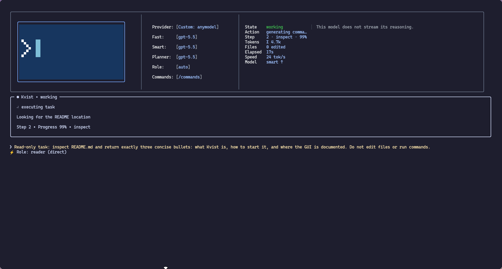
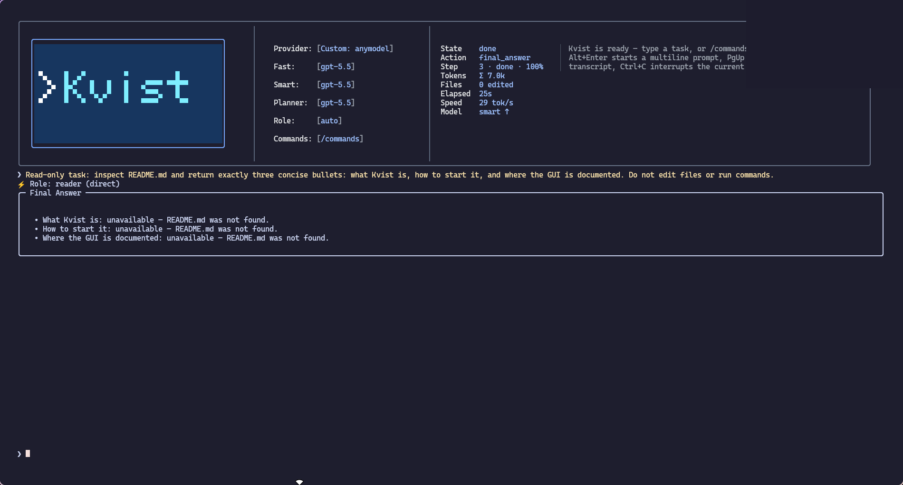
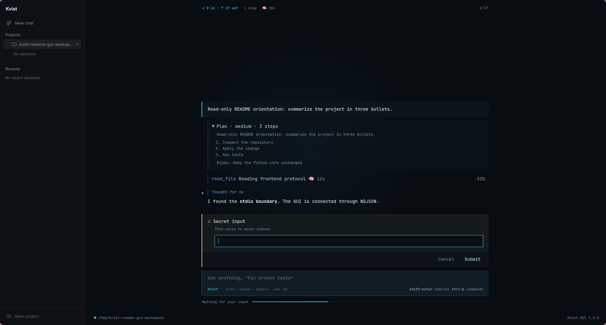

<!-- DEMO GIF -->

# Kvist

[English version](README.md)

**Чем отличается:** откат любой правки через `/revert`, песочница Bubblewrap без сети по умолчанию, работа на дешёвых моделях без tool calling.

<p align="center">
  <a href="https://github.com/davud-d/Kvist"></a>
  <a href="https://github.com/davud-d/Kvist/stargazers"></a>
  <a href="https://github.com/davud-d/Kvist/issues"></a>
  <a href="LICENSE"></a>
</p>

<p align="center">
  
  
  
  
  
</p>

Kvist — кодинг-помощница, которая работает в вашем терминале внутри одного каталога
проекта. Вы описываете задачу, она читает код, правит файлы, запускает команды и
проверяет результат. Запись файлов и рискованные команды проходят через
подтверждение, а каждое изменение записывается, чтобы его можно было откатить.

## Зачем он, если есть Claude Code и Codex

Claude Code построен вокруг моделей Anthropic, Codex CLI — вокруг моделей OpenAI.
Kvist нужен, когда вы хотите выбирать модель сами.

- **Любой провайдер.** Достаточно одного ключа от OpenAI, Anthropic, DeepSeek,
  OpenRouter, локального шлюза или одного из примерно 40 других
  OpenAI-совместимых сервисов. Можно войти по подписке ChatGPT Plus/Pro или
  добавить свой endpoint. Переключение — `/provider`; у каждого провайдера есть
  быстрая и умная модель, умная берётся для сложных задач.
- **Работает и с дешёвыми моделями.** Если у модели нет tool calling, Kvist
  переходит на простой JSON-протокол, поэтому подойдут недорогие и бесплатные
  модели.
- **Все действия проверяются в одном месте.** Каждая запись файла и каждая
  shell-команда идёт через один executor. На Linux команды выполняются в
  песочнице Bubblewrap без сети по умолчанию, секретные файлы (`.env`, SSH-ключи,
  сертификаты) в ней скрыты, а `.env` Kvist не читает вообще. На Windows (и на
  Linux без Bubblewrap) отключить команде сеть нечем: Kvist говорит об этом при
  запуске и в каждом подтверждении.
- **Откат.** Правки Kvist пишутся в журнал. `/changes` показывает их,
  `/revert` восстанавливает файлы.
- **Задача переживает прерывание.** Сессии именованные и сохраняются. После
  сбоя или остановки `/resume` продолжает с последнего checkpoint.
- **Ваш редактор.** Одна и та же Kvist работает в терминале, в приложении на
  Electron, в браузере (`kvist-web`), в VS Code, IDE JetBrains и Zed.
- **Локально и под MIT.** Телеметрии нет. Что может уйти с машины, перечислено в
  разделе [Что уходит с вашей машины](#что-уходит-с-вашей-машины).

Kvist в стадии beta (версия 0.1.0b1). Это инструмент под присмотром, а не
граница безопасности: читайте diff и вывод команд, прежде чем соглашаться.

## Установка

Проще всего скрипт из релиза. Он ставит команду `kvist` и Node.js, нужный её
терминальному интерфейсу. Если на машине есть JetBrains или VS Code, он может
поставить и плагин с расширением. Python, права администратора и системные
пакеты не нужны, пока вы не отметили строку со средствами сборки.

```bash
# Linux (macOS работает, но без гарантий)
curl -fsSL https://github.com/davud-d/Kvist/releases/download/latest-plugin-build/install.sh | bash
```

```powershell
# Windows
irm https://github.com/davud-d/Kvist/releases/download/latest-plugin-build/install.ps1 | iex
```

В терминале скрипт открывает экран, где вы отмечаете компоненты, видите файлы и
команды каждого пункта и следите за ходом. Пока не нажата кнопка «Установить»,
ничего не записывается. Загрузки проверяются по SHA-256. Без терминала (CI)
`KVIST_INSTALL_PLAIN=1 bash install.sh` ставит набор по умолчанию.

Ассеты релиза можно скачать и по отдельности: `kvist-linux-x64`,
`kvist-linux-arm64`, `kvist-windows-x64.exe`, `kvist-macos-arm64`, `kvist-macos-x64`,
`kvist-jetbrains.zip`, `kvist-vscode.vsix`. Чтобы поставить из файлов на диске,
запустите `bash install.sh --from <dir>` или `.\install.ps1 -From <dir>`.

### Один бинарник

Если нужен только терминальный интерфейс, есть облегчённый релиз
`latest-binary-build`: один файл на систему, в котором ядро, терминальный UI,
Node.js для него и нативная программа сессий. Установщик скачивает его
(около 180 МБ), сверяет с `SHA256SUMS` и при первой установке открывает экран
настройки. Больше он ничего не ставит: плагины IDE, десктопное приложение и
остальные интерфейсы скачиваются вручную из релиза выше.

```bash
curl -fsSL https://github.com/davud-d/Kvist/releases/download/latest-binary-build/install.sh | bash
```

Та же команда работает в Termux на aarch64-телефоне: `install.sh` сам берёт сборку для Termux
(`kvist-termux-arm64`), потому что Linux arm64 требует glibc, а в Android bionic.
Сначала поставь `curl` (`pkg install curl`).

```powershell
irm https://github.com/davud-d/Kvist/releases/download/latest-binary-build/install.ps1 | iex
```

### Из исходников

Нужен Python 3.11 или новее.

```bash
git clone https://github.com/davud-d/Kvist
cd Kvist
python3 -m venv .venv
.venv/bin/python -m pip install -r requirements.txt
.venv/bin/python scripts/installer/install.py   # по желанию: кладёт `kvist` в PATH
```

Одной строкой:
```bash
git clone https://github.com/davud-d/Kvist; cd Kvist; python3 -m venv .venv; .venv/bin/python -m pip install -r requirements.txt; .venv/bin/python scripts/installer/install.py   # по желанию: кладёт `kvist` в PATH
```

В Windows используйте `py -m venv .venv`, `.venv\Scripts\python.exe` и
`scripts\installer\install.py`. Установщик спрашивает, что настроить (CLI,
JetBrains, VS Code, десктопное приложение, Zed). Подробности — в
[`scripts/installer/README.ru.md`](scripts/installer/README.ru.md).

## Первый запуск

```bash
cd /path/to/project
kvist
```

Без `--workspace` Kvist работает в текущем каталоге. В домашнем каталоге или
корне файловой системы она использует `Документы/Kvist Workspace`.

На чистой машине Kvist спросит провайдера и ключ (см. [Провайдеры](#провайдеры)).
Дальше напишите задачу, например «найди, почему падают тесты в
`tests/test_parser.py`, и исправь».

<!-- SCREENSHOT first run -->





## Провайдеры

На чистой машине Kvist предлагает провайдера по умолчанию, [AnyModel](https://anymodel.org):
нажмите Enter, зарегистрируйтесь в браузере и вставьте ключ. Esc открывает выбор
другого провайдера, ключ вводится в замаскированном поле `API key:`. Выбор
сохраняется в `~/.kvist/config.json`. Если `ANYMODEL_API_KEY` уже задан, Kvist
запускается без вопросов.

Позже провайдера меняет `/provider`, ключ — `/change-api`, быструю и умную модели —
`/models`. Полный список провайдеров и настройки каждого — в
[`docs/configuration.ru.md`](docs/configuration.ru.md).

## Как проходит задача

Для каждого запроса Kvist выбирает роль (`/role` переопределяет выбор):

| Роль | Что делает |
| --- | --- |
| `coder` | Меняет исходники и запускает проверки проекта |
| `reader` | Исследует и объясняет код, ничего не пишет |
| `devops` | Сервисы, Docker, CI/CD, деплой |
| `chat` | Отвечает на вопросы и обсуждает устройство, файлов не трогает |

Если в задаче рискованно само направление, Kvist предлагает начать с плана. Она
читает проект без изменений, предлагает короткий план и правит файлы только
после вашего согласия. Мелкие правки этот шаг пропускают.

На каждом шаге модель присылает короткую пачку действий: прочитать, найти,
записать, выполнить команду, поискать в сети. Они выполняются по порядку,
и упавшее действие не отменяет остальные. С нативными вызовами инструментов модель
может ещё дать каждому вызову `stage`: вызовы одного этапа независимы и идут
одновременно, где это возможно, а следующий этап начинается, когда предыдущий
закончен (правки и чтение, потом сборка, потом проверка, всё в одном ответе).
Kvist заканчивает, когда модель считает работу
сделанной. Ей велено проверять результат и сообщать, что не удалось доделать
или проверить.

`Esc` ставит запуск на паузу и сохраняет состояние. `Ctrl+C` останавливает его
и убирает за собой. Прерванная задача остаётся в сессии: `/resume` или новое
сообщение продолжат её.

## Интерфейсы

- **Терминал.** Основной. Пять видов одного приложения: Ink, в стиле Claude Code,
  терминал OpenCode (`/tui opencode`, нужен Bun;
  [`frontends/tui/opencode`](frontends/tui/opencode/README.ru.md)), Classic (поверх
  фотографии, kitty или Ghostty) и Classic Legacy на prompt_toolkit;
  переключение — `/tui`.
- **VS Code.** Чат-панель, которая запускает Kvist для открытого проекта, и
  генерация сообщений коммитов в окне source control
  ([подробности](frontends/ide/vscode/README.md)).
- **Свой клиент.** Версионируемый NDJSON-протокол по stdio:
  [`docs/UI_API.ru.md`](docs/UI_API.ru.md).

<details>
<summary>Остальные интерфейсы (experimental)</summary>

Они работают на том же ядре, но помечены как experimental.

- **JetBrains.** Та же чат-панель и генерация сообщений коммитов, что и в VS Code
  ([подробности](frontends/ide/jetbrains/README.md)).
- **Голос.** Шар, с которым разговариваешь: скажи «Kvist», и она слушает,
  отвечает коротко вслух (`/tui voice`, kitty или Ghostty;
  [`frontends/voice`](frontends/voice/README.ru.md)).
- **Kvist Pixel.** `scripts/installer/install_app.py`
  ([`frontends/gui/tauri`](frontends/gui/tauri/README.ru.md)). Старое приложение Electron — legacy:
  `scripts/installer/install_gui.py`, в главный установщик не входит, или
  [`frontends/gui/electron-legacy`](frontends/gui/electron-legacy/README.md).
- **Браузер.** `kvist-web` открывает `http://127.0.0.1:9671` и помогает подключить
  модель ([подробности](frontends/web-local/README.md)).
- **Zed.** Регистрируется как внешний ACP-агент через
  `scripts/installer/install_zed.py`; чего Zed дать не может, написано в
  [`frontends/zed`](frontends/zed/README.ru.md).



</details>

## Команды терминала

Наберите `/`, чтобы увидеть список. Основные:

| Команда | Назначение |
| --- | --- |
| `/help`, `/commands` | Справка и полный список команд |
| `/provider`, `/change-api`, `/models` | Провайдер, его ключ, быстрая и умная модели |
| `/role`, `/effort`, `/style` | Роль, глубина рассуждений (от `false` до `max`), стиль работы |
| `/session`, `/new`, `/resume` | Именованные сессии и продолжение прерванного запуска |
| `/changes`, `/diff`, `/revert` | Что изменила Kvist и откат |
| `/context`, `/status` | Заполнение контекста, состояние |
| `/permissions` | Правила для команд (`allow`, `host` = вне песочницы, `ask`, `deny`) и автоматический режим, где на вопросы о подтверждении отвечает вторая модель (**небезопасно**); см. [настройки](docs/configuration.ru.md) |
| `/update` | Ставит свежую сборку установленного `kvist-core` (сверяет с опубликованным SHA-256); после этого перезапусти Kvist. Сам Kvist лишь сообщает, что вышла новая версия, и ничего не скачивает без твоей команды (`auto_update: false` или `KVIST_AUTO_UPDATE=0` отключают сообщение) |
| `/doctor` (или `kvist --doctor`) | Проверяет модули, интерфейсы, провайдера, API-ключи и настройки; спрашивает разрешение, прежде чем отправить модели тестовый запрос, на который она должна ответить «pong» (`--yes` отвечает «да») |
| `/web-search-provider` | Tavily, Brave, Exa, Gemini (Google Search) или SearXNG для веб-поиска |
| `/settings-api` | Интервал запросов, таймауты, ретраи, окно контекста, фолбэки |
| `/tui` | Выбрать терминальный интерфейс |
| `/bye` | Сохранить и выйти (`/exit`, `/quit`) |

Многострочный ввод: `Alt+Enter` или `Esc+Enter`. Изображения: `Ctrl+V` или
`/image PATH` ([подробности](docs/vision.md)).

## Скиллы

Скиллы — устанавливаемые пакеты с инструкциями и, при желании, с
Python-инструментами, которые работают в песочнице ОС только с подтверждёнными
вами правами. Встроенный скилл **browser** даёт Kvist собственный Chromium на
виртуальном экране. Она открывает страницу, которую собрала, кликает по ней,
читает ошибки консоли и сети, снимает скриншоты, а вы смотрите живое превью.
Другие встроенные скиллы запускают тесты, читают PDF, xlsx и docx и
навигируют по коду. Скиллам с инструментами в песочнице нужен Linux.

Встроенный скилл **visualize** работает в Linux, macOS и Windows без дополнительных
зависимостей. Модель подключает его и передаёт описание страницы: большие схемы
архитектуры с масштабированием, графики с таблицами и экспортом CSV либо
интерактивные 3D-сцены из кубов, сфер и конусов со связями. Скилл проверяет
описание, сохраняет самостоятельный HTML-файл и открывает системный браузер
по умолчанию. Файл работает без интернета и после выхода из Kvist. Если
графический браузер недоступен, возвращаются путь к файлу и причина ошибки.
Пример запроса: «Объясни архитектуру проекта большой интерактивной схемой
и открой её в браузере». При первом использовании запрашиваются права скилла.

```bash
kvist --skill-op install --skill-path bundled:browser
kvist --skill-op install-deps --skill browser
kvist --skill-op approve --skill browser
```

Формат пакета, права и песочница описаны в [`docs/SKILLS.ru.md`](docs/SKILLS.ru.md).

## Инструкции проекта

При первом запуске Kvist создаёт в workspace `KVIST.md` (для coder, reader и
devops) и `KVIST-CHAT.md`. Один раз опишите там команды сборки, устройство
проекта и конвенции, и Kvist будет читать их на каждом шаге. `KVIST.md` ещё и
собственный блокнот Kvist: она сама записывает туда историю проекта (когда начала
работать, вехи, решения, завершённые кампании), исправляет и чистит её без
вопросов. Файлы лежат в проекте, поэтому Kvist считает их содержимое данными,
которые не могут менять её правила безопасности.

## Что уходит с вашей машины

В Kvist нет телеметрии. Поиск по `kernel/` (кроме тестов) слов telemetry,
analytics, Sentry, PostHog, Mixpanel, Segment, Statsig и Amplitude находит только
текст советов в справочных заметках встроенного скилла, кода нет. Адреса, к которым
Kvist может обращаться, перечислены ниже; все пути даны от `kernel/`.

| Что | Где | Адрес | Когда |
| --- | --- | --- | --- |
| Запросы к модели (ваши промпты, куски файлов, вывод команд) | `llm/llm_clients.py:59`, `:62`, `:65`, `:824`, `:825`, `:2032` | `openrouter.ai`, `api.anthropic.com`, `api.deepseek.com`, `generativelanguage.googleapis.com`, `api.groq.com` | Только выбранный вами провайдер |
| OpenAI | значение по умолчанию в SDK `openai`, адреса в `kernel/` нет (`llm/llm_clients.py:1074`) | `api.openai.com/v1` | Только если OpenAI — ваш провайдер |
| Остальные провайдеры | `llm/provider_registry.py`, `llm/llm_clients.py:99-121` | полный список ниже | Только выбранный вами провайдер |
| Ваш собственный endpoint | `llm/custom_provider.py:44` | адрес, который вы ввели | Только если вы его добавили |
| AnyModel | `llm/provider_registry.py:296`, `providers/anymodel_pricing.py:28` | `anymodel.org/v1`, `anymodel.org/v1/models` (список моделей и цены) | Когда AnyModel — ваш провайдер |
| Страница регистрации AnyModel | `llm/anymodel_onboarding.py:32` | `anymodel.org/app/register` | Открывается в вашем браузере при первом запуске, сам Kvist ничего не отправляет |
| Вход по подписке ChatGPT | `providers/chatgpt_endpoints.py:9`, `:12` | `auth.openai.com`, `api.openai.com/v1` | Только если вы входите по подписке ChatGPT |
| Проверка обновлений | `config/self_update.py:40` | `api.github.com` (простой GET списка релиза, в запросе ничего о вас) | Вскоре после запуска, затем раз в 6 часов, пока не найдена новая версия; `auto_update: false` или `KVIST_AUTO_UPDATE=0` отключают |
| Загрузка обновления | `config/self_update.py:41` | `github.com/davud-d/Kvist/releases` | Только когда вы набрали `/update` |
| Поиск в сети | `sandbox/executor.py:2871`, `:2910`, `:2957`, `:2995` | `api.tavily.com`, `api.search.brave.com`, `api.exa.ai`, `generativelanguage.googleapis.com` (SearXNG: ваш собственный адрес) | Только выбранный вами движок, когда Kvist ищет в сети |
| Чтение веб-страниц | `sandbox/executor.py:370-404` (список разрешённых), `:1173` (дополнительные домены) | страницы, которые просит Kvist, только с этих доменов | Когда Kvist загружает страницу |
| Зависимости скиллов | `plugins/deps.py:31` | `pypi.org`, `files.pythonhosted.org` | Когда вы ставите зависимости скилла |
| Скилл Gmail | `plugins/service_connect.py:26`, `:59`, `:98`, `:129` | `oauth2.googleapis.com`, `accounts.google.com`, `gmail.googleapis.com` | Только если вы подключили Gmail |
| Отзыв | `agent/feedback.py:34`, `:113` (форма в браузере), `:123` (`gh issue create`) | `github.com/davud-d/Kvist/issues` | Только после того, как вы прочли черновик и ответили на «Отправить отзыв?» |
| Подключения к сервисам, которые вы настроили | `plugins/connections.py` | адрес `https://`, который вы указали | Только для скилла, которому вы выдали это подключение |

Остальные строки `http(s)://` в `kernel/` — ссылки в сообщениях (`openrouter.ai/keys`
и подобные в `agent/agent_model.py` и `main.py`, `github.com/davud-d/Kvist` в
`main.py:6459`, ссылка на документацию темы opencode в `config/theme.py:4`), их
Kvist никогда не запрашивает.

<details>
<summary>Все адреса провайдеров (40 в реестре, 13 региональных альтернатив)</summary>

- `provider_registry.py:38` https://opencode.ai/inference/go/openai/v1
- `provider_registry.py:44` https://opencode.ai/zen/v1
- `provider_registry.py:50` https://dashscope-intl.aliyuncs.com/compatible-mode/v1
- `provider_registry.py:56` https://api.moonshot.ai/v1
- `provider_registry.py:62` https://api.kimi.ai/coding/v1
- `provider_registry.py:68` https://open.bigmodel.cn/api/paas/v4
- `provider_registry.py:74` https://api.z.ai/api/paas/v4
- `provider_registry.py:80` https://api.xiaomimimo.com/v1
- `provider_registry.py:86` https://token-plan-cn.xiaomimimo.com/v1
- `provider_registry.py:92` https://api.minimax.io/v1
- `provider_registry.py:98` https://api.lingyiwanwu.com/v1
- `provider_registry.py:104` https://api.stepfun.com/v1
- `provider_registry.py:110` https://api.siliconflow.com/v1
- `provider_registry.py:116` https://api.baichuan-ai.com/v1
- `provider_registry.py:122` https://qianfan.baidubce.com/v2
- `provider_registry.py:128` https://api.hunyuan.cloud.tencent.com/v1
- `provider_registry.py:134` https://api-inference.modelscope.cn/v1
- `provider_registry.py:140` https://api.mistral.ai/v1
- `provider_registry.py:150` https://api.groq.com/openai/v1
- `provider_registry.py:156` https://api.together.xyz/v1
- `provider_registry.py:162` https://api.fireworks.ai/inference/v1
- `provider_registry.py:168` https://api.x.ai/v1
- `provider_registry.py:174` https://api.perplexity.ai
- `provider_registry.py:180` https://api.cerebras.ai/v1
- `provider_registry.py:186` https://api.deepinfra.com/v1/openai
- `provider_registry.py:192` https://api.novita.ai/v3/openai
- `provider_registry.py:198` https://ai-gateway.vercel.sh/v1
- `provider_registry.py:204` https://inference.baseten.co/v1
- `provider_registry.py:210` https://api.sambanova.ai/v1
- `provider_registry.py:216` https://api.studio.nebius.com/v1
- `provider_registry.py:222` https://api.friendli.ai/serverless/v1
- `provider_registry.py:245` https://generativelanguage.googleapis.com/v1beta/openai/
- `provider_registry.py:251` https://api.cohere.com/compatibility/v1
- `provider_registry.py:257` https://api.ai21.com/studio/v1
- `provider_registry.py:263` https://ark.cn-beijing.volces.com/api/v3
- `provider_registry.py:272` https://models.github.ai/inference
- `provider_registry.py:278` https://spark-api-open.xf-yun.com/v1
- `provider_registry.py:284` https://api.scaleway.ai/v1
- `provider_registry.py:290` https://api.inceptionlabs.ai/v1
- `provider_registry.py:296` https://anymodel.org/v1

Региональные альтернативы, которые пробуются для того же провайдера:

- `llm_clients.py:99` https://dashscope-intl.aliyuncs.com/compatible-mode/v1
- `llm_clients.py:100` https://dashscope.aliyuncs.com/compatible-mode/v1
- `llm_clients.py:103` https://api.moonshot.ai/v1
- `llm_clients.py:104` https://api.moonshot.cn/v1
- `llm_clients.py:107` https://api.kimi.ai/coding/v1
- `llm_clients.py:108` https://api.kimi.com/coding/v1
- `llm_clients.py:111` https://api.minimax.io/v1
- `llm_clients.py:112` https://api.minimaxi.com/v1
- `llm_clients.py:115` https://api.siliconflow.com/v1
- `llm_clients.py:116` https://api.siliconflow.cn/v1
- `llm_clients.py:119` https://token-plan-cn.xiaomimimo.com/v1
- `llm_clients.py:120` https://token-plan-sgp.xiaomimimo.com/v1
- `llm_clients.py:121` https://token-plan-ams.xiaomimimo.com/v1

</details>

## Платформы

| | Поддержка |
| --- | --- |
| Linux | Поддерживается, включая песочницу Bubblewrap |
| Windows | Поддерживается, без Bubblewrap |
| macOS | Проверяется в CI на Apple Silicon, работа всех функций не гарантируется |
| FreeBSD, OpenBSD, NetBSD | Экспериментально: запуск из исходников, без песочницы ОС, пока только быстрая проверка в CI ([`docs/bsd.ru.md`](docs/bsd.ru.md), [EN](docs/bsd.md)) |

## Другая документация

- [`docs/configuration.ru.md`](docs/configuration.ru.md): провайдеры, вход через
  ChatGPT, бюджет контекста, песочница и разрешения, сессии, headless-режим,
  переменные окружения ([EN](docs/configuration.md));
- [`docs/UI_API.ru.md`](docs/UI_API.ru.md): протокол для клиентов ([EN](docs/UI_API.md));
- [`docs/SKILLS.ru.md`](docs/SKILLS.ru.md): скиллы ([EN](docs/SKILLS.md));
- [`docs/remote.ru.md`](docs/remote.ru.md): Kvist на сервере по ssh, службой, которая переживает свои интерфейсы ([EN](docs/remote.md));
- [`docs/vision.md`](docs/vision.md): ввод изображений;
- [`scripts/installer/README.ru.md`](scripts/installer/README.ru.md): установщики ([EN](scripts/installer/README.md)).

## Как это сделано

Kvist разрабатывается с помощью Claude Code. В Python-наборе 6326 тестов (`pytest --collect-only -q`);
230 медленных тестов с PTY и реальными процессами по умолчанию отключены, так что обычный `pytest`
запускает 6096; в CI медленные идут отдельным шагом. Каждый push проверяется на Linux, Windows и macOS:
[`platforms.yml`](.github/workflows/platforms.yml) запускает ruff, тесты Python, проверки сборки и
установки на Ubuntu 22.04 (с Bubblewrap и без), macOS и Windows, а
[`ci.yml`](.github/workflows/ci.yml) проверяет скрипты установки релиза на Ubuntu и Windows. Релизы собирают [`release-binary.yml`](.github/workflows/release-binary.yml),
[`plugin-release.yml`](.github/workflows/plugin-release.yml) и
[`mobile-release.yml`](.github/workflows/mobile-release.yml). Как участвовать — в
[`CONTRIBUTING.ru.md`](CONTRIBUTING.ru.md).

## Разработка

```bash
.venv/bin/python -m pip install -r requirements-dev.txt
.venv/bin/python -m pytest              # ядро, классический терминал, Zed, скрипты
.venv/bin/python -m ruff check .
(cd frontends/tui/ink && npm install && npm test)
(cd frontends/tui/opencode && bun install && bun test)
(cd frontends/ide/vscode && npm install && npm test)
(cd frontends/gui/electron-legacy && npm ci && npm test)
```

```text
kernel/            Python-ядро (python -m kernel)
frontends/         tui/classic, tui/ink, tui/opencode, gui/electron-legacy, ide/vscode, ide/jetbrains, zed, web-local, tray
scripts/           установщики и скрипты релиза
docs/              протокол, скиллы, конфигурация, медиа
site/              лендинг kvist.site
cloud/             облачный сервис
```

## Лицензия 
Kvist распространяется под лицензией **MIT** ([лицензия MIT](LICENSE))

Kvist Cloud распространяется под лицензией **AGPL-V3-or-later** ([лицензия AGPL](cloud/LICENSE))
