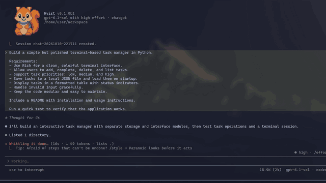
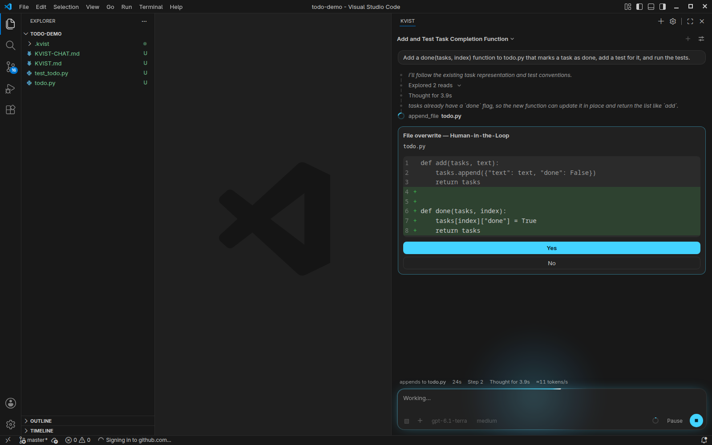
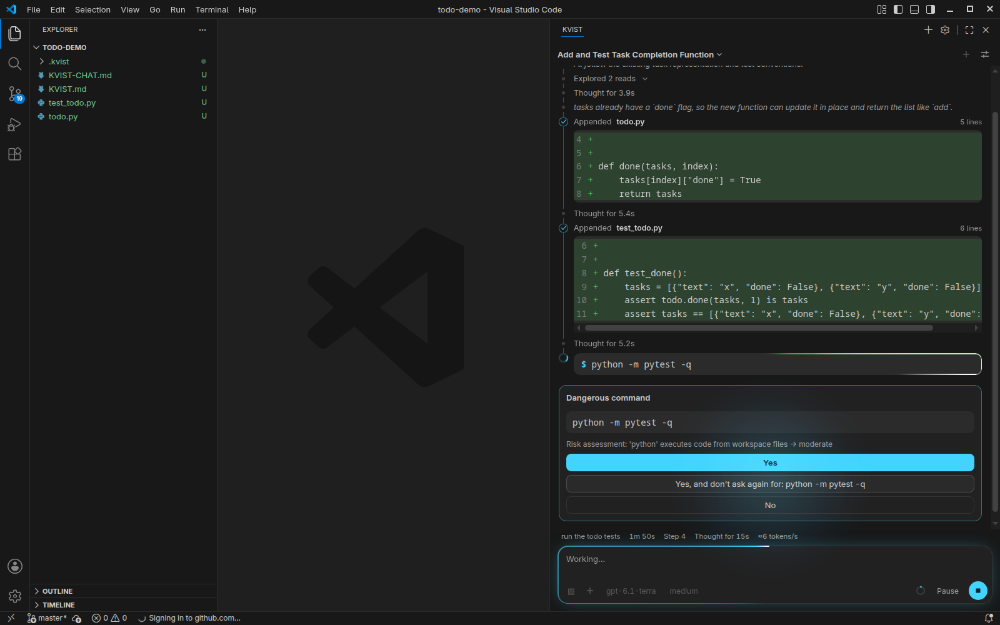
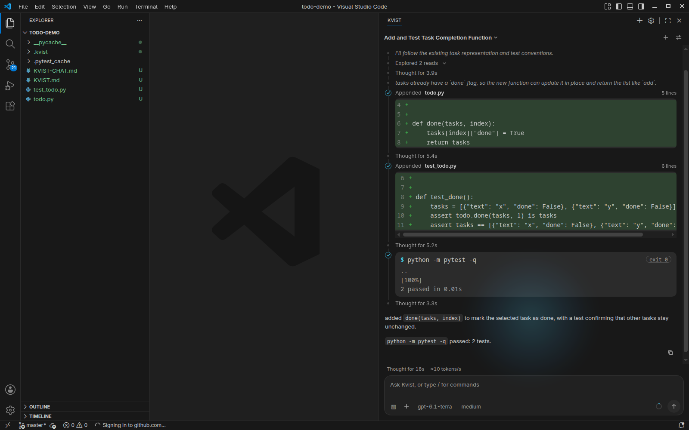
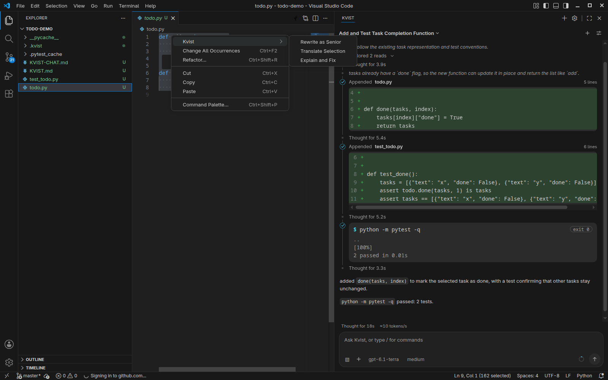
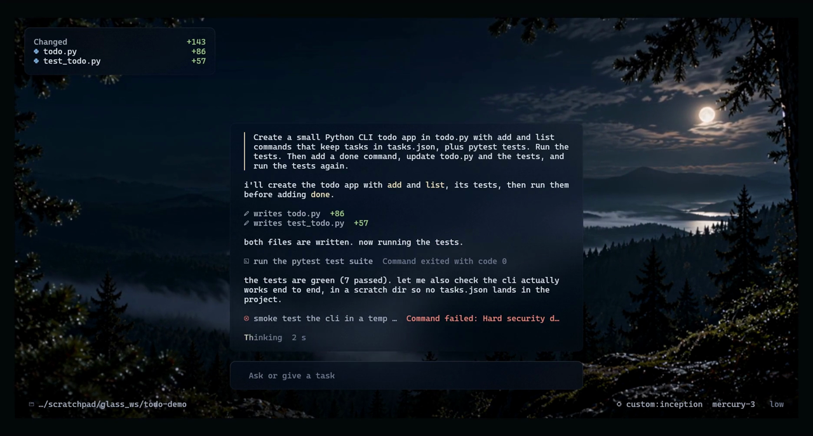

# Kvist for VS Code

The animations are short previews. Full videos at 60 fps: [Classic interface](https://youtu.be/eF0gsdJZCfA), [Claude-style interface](https://youtu.be/6idLmVHNBgk).

Kvist is a coding agent that works on one project folder at a time. You describe a task, it reads the code, edits files, runs commands and tests, and reports what it did. This extension puts it in VS Code: a chat panel in the secondary side bar, commit messages from your staged changes, inline suggestions, and rewrite, translate and explain actions for selected text.

The agent runs on your machine as a bundled program. It talks to the model provider you pick and to nothing else you did not ask for. Your API key stays in `~/.kvist/config.json`.

## What you get

- A chat panel in the secondary side bar, also available as an editor tab. Streamed answers, file edits shown as diffs, and a question box when the agent needs a decision.
- Commit messages. Click the sparkle icon in Source Control and the message is written from your staged diff and the style of your recent commits.
- Inline completion. Ghost text from your configured fast model.
- Selection actions in the editor context menu under Kvist: Rewrite as Senior, Translate Selection, Explain and Fix. Each opens a diff and applies nothing until you press Apply.
- The same agent in a terminal, started from the Command Palette with `Kvist: Open Kvist in Terminal`.

## Safety

Shell commands run in a sandbox (Bubblewrap on Linux) with a private home directory and no network by default. Files named `.env` are never read or written, and keys, certificates and SSH folders are hidden from commands. The agent asks before running anything risky and before overwriting a file. Every change goes into a journal, and `/revert` undoes what the agent wrote.

## Getting started

1. Install the extension and open a project folder.
2. Open the Kvist icon in the secondary side bar (Ctrl+Alt+B toggles it) and choose a provider on the first screen.
3. Type a task, for example "add a --verbose flag to the CLI and cover it with a test".

Kvist works with AnyModel, OpenAI, Anthropic, DeepSeek, OpenRouter, ChatGPT sign-in, a local OpenAI-compatible gateway, and about forty other OpenAI-compatible providers. Answers and prompts are written in English or Russian, matching the language you use.

## Kvist in the terminal

The same core also has full-screen terminal interfaces, shown at the top of this page: Classic and Claude-style. You pick one the first time you start Kvist outside the editor, and you can switch later with `/tui`.

The Claude-style interface follows the layout of Claude Code: a transcript with diffs, a spinner with the current step, and a footer with the model and effort level.

## Settings

| Setting | Default | Meaning |
| --- | --- | --- |
| `kvist.binaryPath` | empty | Path to a Kvist executable. Empty means the one inside the extension. |
| `kvist.environment` | `{}` | Environment variables for the core, such as `AGENT_SANDBOX_MODE` or `AGENT_SANDBOX_NET`. Stored in plain text, so keep API keys in the provider settings. |
| `kvist.inlineCompletion.enabled` | `true` | Turns inline suggestions on or off. |
| `kvist.inlineCompletion.debounceMs` | `100` | Pause after typing before a suggestion is requested. |

Inline suggestions go to a separate `kvist --complete-server` process, so a running agent task never delays them. A manual inline-suggestion request skips the pause.

When the text you typed is wrong (a typo, a stale name), Kvist can suggest a replacement and VS Code can show the old text struck through. That display needs a VS Code proposed API, which the Marketplace does not allow in a published extension. To get it, install the package ending in `-proposals.vsix` from the [GitHub releases](https://github.com/davud-d/Kvist/releases) and start VS Code with `--enable-proposed-api kvist.kvist` (or add `"enable-proposed-api": ["kvist.kvist"]` to `argv.json`). Without it, the same suggestion appears as ordinary ghost text or not at all. A newly entered API key needs a window reload.

## Requirements

- VS Code 1.106 or newer.
- Windows x64, Linux x64, or macOS (Apple Silicon and Intel). The macOS builds are included but nobody has run them on a Mac yet, so expect rough edges there.
- A Git repository in the folder for commit messages.
- An API key for one of the providers above, or a local gateway.

## Links

- Source and issues: https://github.com/davud-d/Kvist
- Kvist site: https://kvist.site
- Building from source: [BUILD.md](BUILD.md)

## License

MIT. Third-party notices are in `resources/THIRD_PARTY_NOTICES.txt`.
